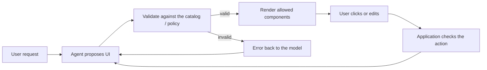

# GenUX codelabs: Generative UI with A2UI, AG-UI, MCP Apps, json-render, OpenUI Lang and a harness

Ask an agent how a bike-share station is doing. It could answer with a paragraph, or with an interface: a card, a chart, a button that does something. **Generative UI turns an agent's output into an interface**, while the application still decides what it accepts, what it renders and which actions it permits.

This repository is a set of **24 runnable codelabs**: six technologies, each in the four generation modes.

| | **Static**<br>the model picks a pre-built component | **Declarative**<br>the model composes from a catalog | **Open-ended**<br>the model writes HTML/JS | **Mixed**<br>catalog + one sandboxed generated region |
|---|---|---|---|---|
| **[01 · A2UI](codelabs/01_a2ui/README.md)** | [fixed templates, streaming data](codelabs/01_a2ui/01_static/README.md) | [the model writes components](codelabs/01_a2ui/02_declarative/README.md) | [custom catalog: HtmlFrame](codelabs/01_a2ui/03_open_ended/README.md) | [Basic Catalog + HtmlFrame](codelabs/01_a2ui/04_mixed/README.md) |
| **[02 · AG-UI](codelabs/02_ag_ui/README.md)** | [tool calls are components](codelabs/02_ag_ui/01_static/README.md) | [the UI is shared state](codelabs/02_ag_ui/02_declarative/README.md) | [HTML over a CUSTOM event](codelabs/02_ag_ui/03_open_ended/README.md) | [state + artifact + human in the loop](codelabs/02_ag_ui/04_mixed/README.md) |
| **[03 · MCP Apps](codelabs/03_mcp_apps/README.md)** | [pre-built ui:// view](codelabs/03_mcp_apps/01_static/README.md) | [generic spec renderer](codelabs/03_mcp_apps/02_declarative/README.md) | [nested sandbox](codelabs/03_mcp_apps/03_open_ended/README.md) | [catalog + generated region](codelabs/03_mcp_apps/04_mixed/README.md) |
| **[04 · json-render](codelabs/04_json_render/README.md)** | [a catalog of widgets](codelabs/04_json_render/01_static/README.md) | [streamed patches, $state](codelabs/04_json_render/02_declarative/README.md) | [HtmlArtifact in chunks](codelabs/04_json_render/03_open_ended/README.md) | [setState + two renderers](codelabs/04_json_render/04_mixed/README.md) |
| **[05 · OpenUI Lang](codelabs/05_openui/README.md)** | [one statement](codelabs/05_openui/01_static/README.md) | [forward references](codelabs/05_openui/02_declarative/README.md) | [HtmlArtifact(title, doc, data)](codelabs/05_openui/03_open_ended/README.md) | [library + HtmlArtifact](codelabs/05_openui/04_mixed/README.md) |
| **[06 · Harness](codelabs/06_harness/README.md)** | [render tools](codelabs/06_harness/01_static/README.md) | [render_ui: errors are results](codelabs/06_harness/02_declarative/README.md) | [render_html + permission](codelabs/06_harness/03_open_ended/README.md) | [the whole loop](codelabs/06_harness/04_mixed/README.md) |

Start with [Part 0 · the shared plumbing](common/README.md), then go row by row (one technology at a time) or column by column (one mode across technologies). Every codelab README has the commands, the **recorded output** of its demo, screenshots, a step-by-step **code walkthrough** with snippets from the real files, and exercises. Videos: see [videos/README.md](videos/README.md).

## Two decisions, not one

**What may the model generate?** (the columns)
- **Static:** components exist in your code. The model selects one and supplies values.
- **Declarative:** the model describes a layout using a catalog of allowed components. Your renderer draws it.
- **Open-ended:** the model writes markup and code. It needs a restricted environment: a content policy, a CSP and a sandboxed iframe.
- **Mixed:** catalog by default, plus one sandboxed region where the catalog falls short.

**How does the UI reach the user?** (the rows)
- **A2UI, json-render, OpenUI Lang** are *representations*: ways to describe a UI.
- **AG-UI** is a *transport* between your agent and your own frontend.
- **MCP Apps** is a *host integration*: someone else's app (Claude, ChatGPT, VS Code...) mounts your UI.
- **The harness** is where the agent lives: UI becomes tools, permissions and turns.

A representation and a transport are separate choices. The codelabs keep that visible: A2UI travels over plain SSE here; AG-UI carries element maps and HTML; MCP Apps carries specs and HTML in `structuredContent`.



A click sends a named action back to the application. It is a request, not a permission: every codelab checks the action, its source and its parameters before anything runs.

## The running example

All 24 codelabs use the same small domain, a bike-share network (`common/genui_common/bikes.py`): a station card, a network dashboard, a broken-bike report form, a trip-cost calculator and a rebalancing simulator. Because the UI is the same everywhere, the differences you see are the differences between the technologies.

## Quick start

Requirements: Python 3.10+ (tested on 3.11), Node 20+ (for the browser-module unit tests), and optionally Playwright's Chromium for screenshots.

```bash
git clone https://github.com/pgala3183/A2UI.git
cd A2UI
python -m pip install -r requirements.txt
python -m playwright install chromium      # optional: screenshots in demo.py

python run_all.py                           # every offline test (161 tests, 31 directories)
python run_all.py --demos                   # also run every demo, record its output into the READMEs
python check_snippets.py                    # every README snippet exists in the file it names
```

Run one codelab:

```bash
cd codelabs/01_a2ui/01_static
python demo.py        # prints the wire traffic, drives the page headlessly, saves demo.png
python server.py      # interactive: open http://127.0.0.1:8101
python -m pytest -q   # its offline tests
```

| Theme | static | declarative | open-ended | mixed |
|---|---|---|---|---|
| A2UI | 8101 | 8102 | 8103 | 8104 |
| AG-UI | 8201 | 8202 | 8203 | 8204 |
| MCP Apps (host page; MCP at `/mcp`) | 8301 | 8302 | 8303 | 8304 |
| json-render | 8401 | 8402 | 8403 | 8404 |
| OpenUI Lang | 8501 | 8502 | 8503 | 8504 |
| Harness (also `python cli.py "..."`) | 8601 | 8602 | 8603 | 8604 |

## Scripted model by default, Claude when you ask

Every codelab writes down, in its `agent.py` or `server.py`, the reply a model is expected to give (`respond()`), and runs it through `ScriptedLLM`: same events, same streaming, no network, no cost. That makes the tests and recorded demos reproducible. Some scripted replies make realistic mistakes on purpose (an unknown component, a string where a number belongs) so the validation and correction loops have something to catch.

To run against Claude instead, set `GENUI_LIVE=1` and an `ANTHROPIC_API_KEY` (model `claude-opus-5-5` by default; change it with `GENUI_MODEL`). The live path is implemented in `common/genui_common/llm.py`; the recorded outputs in this repository come from the scripted model.

## What is official and what is hand-written

| Technology | In these codelabs |
|---|---|
| A2UI | v0.9 message shapes; envelopes, catalog validation and renderer written by hand (no `@a2ui/*` package) |
| AG-UI | events written by hand; **tests validate every event against the official `ag-ui-protocol` models**; a small client modelled on `@ag-ui/client`'s `HttpAgent` |
| MCP Apps | **real FastMCP servers (`mcp` Python SDK 1.x)**, tested with the official MCP client too; the host page and view kit are hand-written; every server also runs over stdio for real hosts |
| json-render | the spec, `$state`, actions, `setState` and SpecStream contract, implemented without React/Zod |
| OpenUI Lang | a hand-written parser (Python and JavaScript twins) for the language's core, not `@openuidev/*` |
| Harness | a small harness written for this course (tools, permissions, loop, two surfaces) |

Hand-written implementations keep every field visible, which is the point of a codelab. They are not substitutes for the official libraries in production.

## Repository layout

```text
common/                 Part 0: shared Python (genui_common/) and browser modules (web/)
codelabs/
  01_a2ui/ ... 06_harness/
    README.md           the theme: what the technology is, how the four modes map onto it
    _shared/            the theme's protocol code, used by its four codelabs (+ test_shared.py)
    01_static/ 02_declarative/ 03_open_ended/ 04_mixed/
      README.md         walkthrough + recorded output + screenshots
      agent.py          prompt, tools, and the scripted model's reply   (some themes keep these in server.py)
      server.py         the server for this codelab
      page/             index.html + app.mjs (MCP Apps: view.html + the shared host page)
      demo.py           runs it end to end; demo_output.txt and demo*.png are its recorded output
      test_step.py      offline tests
videos/                 recording guide and a narration script per part
run_all.py              all tests (and demos); check_snippets.py: README snippets match the code
```

## Credits

The course structure follows the GenUI series in [dlmastery/simple-coding-harness](https://github.com/dlmastery/simple-coding-harness/tree/main/genui) (the static / declarative / open-ended / hybrid map from the State of Generative UI report). The code, domain and codelabs in this repository are written for this assignment.
