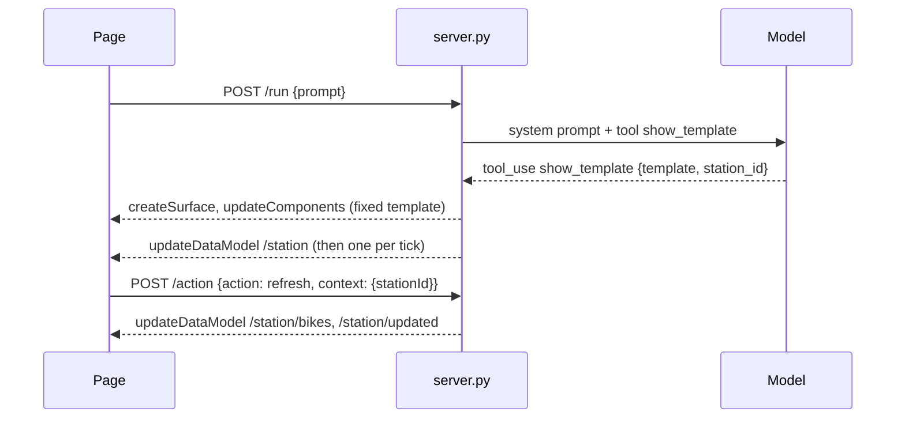
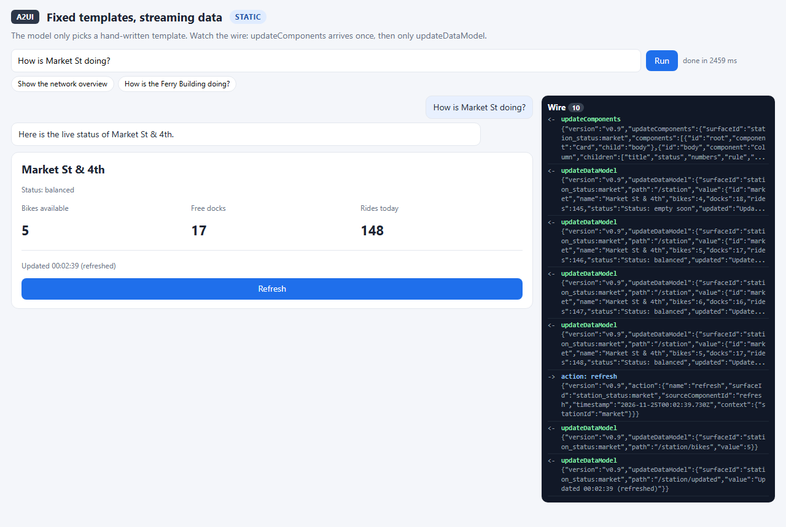

# A2UI · Static: fixed templates, streaming data

**Mode:** static · **Run:** `python server.py` → http://127.0.0.1:8101 · **Demo:** `python demo.py`

The developer writes the A2UI components ahead of time. The model's whole job is one tool call: pick a template and a station. The application fills the template's data model, then keeps the card live with data-only updates.

## What you will learn

- The four A2UI envelopes and the order a client needs them in.
- Why separating structure (`updateComponents`) from data (`updateDataModel`) matters: the layout is sent once, then only data moves.
- How a button's `action` becomes a client-to-server envelope whose `context` is resolved from the data model at click time.

## How it works



## Run it

```bash
python demo.py        # prints the wire traffic, drives the page headlessly, saves demo.png
python server.py      # open http://127.0.0.1:8101 and click Run
python -m pytest -q   # offline tests
```

## Recorded output

<!-- demo-output:start -->
```text

=== 1. The model's whole job: one tool call ===
  {"tool":"show_template","input":{"template":"station_status","station_id":"market"}}

=== 2. The A2UI stream for that call ===
  {"version":"v0.9","createSurface":{"surfaceId":"station_status:market","catalogId":"https://a2ui.org/specification/v0_9/basic_catalog.jso...
  {"version":"v0.9","updateComponents":{"surfaceId":"station_status:market","components":[{"id":"root","component":"Card","child":"body"},{...
  {"version":"v0.9","updateDataModel":{"surfaceId":"station_status:market","path":"/station","value":{"id":"market","name":"Market St & 4th...
  {"version":"v0.9","updateDataModel":{"surfaceId":"station_status:market","path":"/station","value":{"id":"market","name":"Market St & 4th...
  {"version":"v0.9","updateDataModel":{"surfaceId":"station_status:market","path":"/station","value":{"id":"market","name":"Market St & 4th...
  {"version":"v0.9","updateDataModel":{"surfaceId":"station_status:market","path":"/station","value":{"id":"market","name":"Market St & 4th...
  bytes by message type: {'createSurface': 147, 'updateComponents': 1794, 'updateDataModel': 1014}
  the layout was sent once; every later message carried data only

=== 3. A button action, answered by the application ===
  {"version":"v0.9","updateDataModel":{"surfaceId":"station_status:market","path":"/station/bikes","value":4}}
  {"version":"v0.9","updateDataModel":{"surfaceId":"station_status:market","path":"/station/updated","value":"Updated 00:02:35 (refreshed)"}}

=== 4. In the browser ===
  surface text: Market St & 4th |  | Status: balanced |  | Bikes available |  | 5 |  | Free docks |  | 17 |  | Rides today |  | 148 |  | Updated 00:02:39 |  | Refresh
  after Refresh: Updated 00:02:39 (refreshed)
  wire log entries: deleteSurface, createSurface, updateComponents, updateDataModel, updateDataModel, updateDataModel, updateDataModel, action: refresh, updateDataModel, updateDataModel
  saved demo.png
```
<!-- demo-output:end -->



## Code walkthrough

**1. The template is plain A2UI, written by a person.** Every value is a binding into the data model, so the template contains no data.

`agent.py`:

```python
STATION_STATUS = [
    {"id": "root", "component": "Card", "child": "body"},
    {"id": "body", "component": "Column", "children": ["title", "status", "numbers", "rule", "updated", "refresh"]},
    {"id": "title", "component": "Text", "text": {"path": "/station/name"}, "variant": "h2"},
...
    {"id": "refresh", "component": "Button", "child": "refresh_label", "variant": "primary",
     "action": {"event": {"name": "refresh", "context": {"stationId": {"path": "/station/id"}}}}},
]
```

**2. The model only selects.** Its single tool has an `enum` of template names. It cannot invent a component.

`agent.py`:

```python
TOOLS = [{
    "name": "show_template",
    "description": "Show one of the app's pre-built screens. station_status needs station_id; network_overview does not.",
...
            "template": {"enum": list(TEMPLATES)},
            "station_id": {"enum": [s["id"] for s in bikes.STATIONS]},
```

**3. The server turns the tool call into envelopes.** Structure goes out once; after that the loop sends only `updateDataModel`. Every message passes `emit()`, which validates it against the surface's catalog.

`server.py`:

```python
    yield emit(a2ui.create_surface(surface))
    yield emit(a2ui.update_components(surface, agent.TEMPLATES[template]))
    if template == "station_status":
        yield emit(a2ui.update_data_model(surface, "/station", station_data(station_id)))
        # From here on only data moves. The layout above is never sent again.
        for tick in range(TICKS):
```

**4. The click is answered by the application, not the model.** The action is checked by name and its context is validated before anything runs. The answer uses two granular pointers.

`server.py`:

```python
    if act["name"] == "refresh" and act["surfaceId"] in mirror.surfaces:
        station_id = act["context"].get("stationId")
        if station_id not in {s["id"] for s in network.stations}:
...
        yield emit(a2ui.update_data_model(act["surfaceId"], "/station/bikes", data["bikes"]))
```

**5. On the page, the action envelope is built from the data model at click time.**

`../_shared/surface.mjs`:

```js
  action(component) {
    const event = component.action?.event ?? {};
    const context = {};
    for (const [key, value] of Object.entries(event.context ?? {})) context[key] = this.resolve(value) ?? null;
```

## What to notice

- In the wire panel, `updateComponents` appears once; every later entry is `updateDataModel`. The recorded byte counts show the layout is the expensive part.
- The `network_overview` template has exactly five rows. A static UI cannot grow a sixth row for a sixth station: that limit is what declarative mode removes.
- Asking twice sends `deleteSurface` first: a client must not receive `createSurface` for an id that already exists.

## Try it yourself

1. Add a `Free e-bikes` number to `STATION_STATUS` bound to `/station/ebikes` and add `ebikes` to `station_data()`.
2. Set `A2UI_TICKS=10` and watch the card update ten times without a single new `updateComponents`.
3. Send an action with `stationId: "nowhere"` from the browser console and read the server's error.
