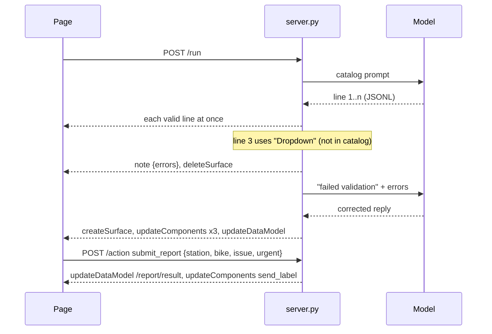
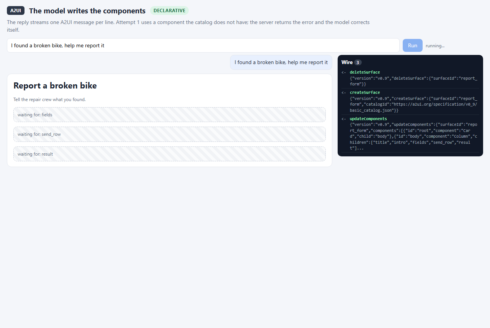
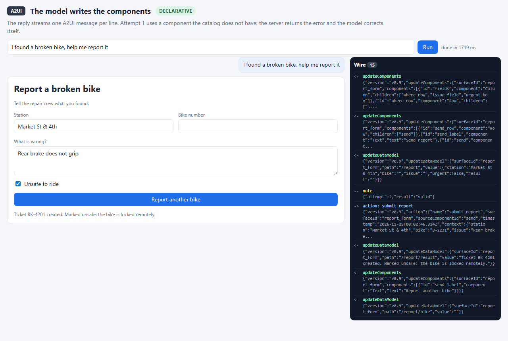

# A2UI · Declarative: the model writes the components

**Mode:** declarative · **Run:** `python server.py` → http://127.0.0.1:8102 · **Demo:** `python demo.py`

The catalog goes into the system prompt and the model writes A2UI messages itself, one JSON object per line. Nothing forces the output to be valid, so the server checks every line against the catalog and feeds the errors back to the model. The page paints each valid message the moment it arrives.

## What you will learn

- How a catalog becomes a prompt (`Catalog.prompt()`), and how the same catalog validates the reply.
- The correction loop: an invalid message stops forwarding, the half-built surface is withdrawn, and the validator's message becomes the next user turn.
- Progressive rendering (ids that have not arrived render as skeletons) and two-way binding (`TextField` writes into the data model).

## How it works



## Run it

```bash
python demo.py
python server.py      # http://127.0.0.1:8102
python -m pytest -q
```

## Recorded output

<!-- demo-output:start -->
```text

=== 1. The catalog becomes the system prompt ===
  system prompt: 1440 chars, 350 tokens (tiktoken o200k_base)
  Catalog https://a2ui.org/specification/v0_9/basic_catalog.json. Components (common props: id,
  component, weight):
  - Text(text, variant?): Text, plain or markdown heading ('# Title').
  - Card(child): A bordered container with exactly one child.
  - Column(children, justify?, align?): Children stacked vertically.
  - Row(children, justify?, align?): Children side by side.
  - Button(child, variant?, action): A button. 'child' is the id of a Text used as its label.
  'action.event' is sent to the server.
  - TextField(label, value?, variant?): A text input bound two-way to the data model through
  'value': {'path': ...}.
  - CheckBox(label, value): A checkbox bound two-way to a boolean in the data model.
  - Divider(axis?): A horizontal rule.

=== 2. The stream: validate each line, correct, retry ===
  createSurface     
  updateComponents  4 components
  {"note":{"attempt":1,"errors":[{"code":"VALIDATION_FAILED","surfaceId":"report_form","path":"/updateComponents/components/4","message":"unknown component 'Dropdown'; this catalog has Text, Card, Co...
  deleteSurface     
  createSurface     
  updateComponents  4 components
  updateComponents  6 components
  updateComponents  4 components
  updateDataModel   /report
  {"note":{"attempt":2,"result":"valid"}}

=== 3. The form in a browser: type, check, click ===
  saved demo_streaming.png
  (mid-stream: ids that have not arrived yet render as skeletons)
  data model after typing: {"report":{"station":"Market St & 4th","bike":"B-2231","issue":"Rear brake does not grip","urgent":true,"result":""}}
  server answer: Ticket BK-4201 created. Marked unsafe: the bike is locked remotely.
  button label now: Report another bike
  saved demo.png
```
<!-- demo-output:end -->

| Mid-stream: skeletons for ids not yet sent | After typing, checking and clicking |
|---|---|
|  |  |

## Code walkthrough

**1. The catalog writes the prompt.** Each component's props come from its JSON Schema, so the prompt and the validator cannot drift apart.

`../_shared/a2ui.py`:

```python
    def prompt(self) -> str:
        lines = [f"Catalog {self.id}. Components (common props: id, component, weight):"]
        for name, (description, props, required) in self.components.items():
            sig = ", ".join(f"{p}{'' if p in required else '?'}" for p in props)
            lines.append(f"- {name}({sig}): {description}")
```

**2. The model sends sections.** The first `updateComponents` names children (`fields`, `send_row`) that arrive in later lines, so the page can paint the frame first.

`agent.py`:

```python
        m("updateComponents", {"components": [
            {"id": "root", "component": "Card", "child": "body"},
            {"id": "body", "component": "Column", "children": ["title", "intro", "fields", "send_row", "result"]},
```

**3. Validate each line as it completes; correct on failure.** The first invalid line stops forwarding. The server reads the rest of the reply (so the model sees it whole), withdraws what it created, and asks again with the errors.

`server.py`:

```python
        for line in lines:
            try:
                message = json.loads(line)
            except ValueError:
                failed = [{"path": "/", "message": f"line is not JSON: {line[:80]}"}]
            else:
                failed = mirror.apply(message) or None
...
        for surface in created:  # withdraw the half-built surface
            mirror.apply(a2ui.delete_surface(surface))
            yield a2ui.delete_surface(surface)
```

**4. Missing ids paint as skeletons.** The renderer walks from `root`; an id that has not arrived yet becomes a placeholder instead of an exception.

`../_shared/render.mjs`:

```js
    const c = s.components.get(id);
    if (!c) return keyed(skeleton(id, 'waiting for'), `missing:${id}`, {});
    if (ancestors.has(id)) return keyed(skeleton(id, 'cycle at'), `cycle:${id}`, {});
```

**5. Two-way binding.** A `TextField` writes into the data model on every keystroke and re-renders. `morph()` keeps the focused input in place, so the caret does not jump.

`../_shared/render.mjs`:

```js
        el = textField({ label: r(c.label), value: r(c.value) ?? '', multiline: c.variant === 'longText' }, (value) => {
          if (path) {
            s.set(path, value); // two-way binding: the input writes into the data model
            this.render();
```

**6. The click is a request, not a permission.** The server validates the form, then answers with data-model updates and one small component update.

`server.py`:

```python
    problems = check_report(act["context"])  # the click is a request, not a permission
    if problems:
        yield a2ui.update_data_model(surface, "/report/result", "Please fix: " + "; ".join(problems))
        return
```

## What to notice

- The recorded output shows `attempt 1` failing at `/updateComponents/components/4` with a message the model can act on, then a `deleteSurface`, then a clean second attempt.
- The prompt costs tokens on every request: the catalog rides along each time (see the token count at the top of the output).
- After `submit_report`, the button text changes via one `updateComponents` with a single component: A2UI updates by id.

## Try it yourself

1. Remove `Dropdown` from the scripted first attempt in `agent.py` and confirm the run succeeds in one attempt.
2. Add a `ChoicePicker` to the catalog in `a2ui.py`, render it in `render.mjs`, and let the model use it for the issue type.
3. Click Send with an empty bike number; read the server's answer in the result text.
