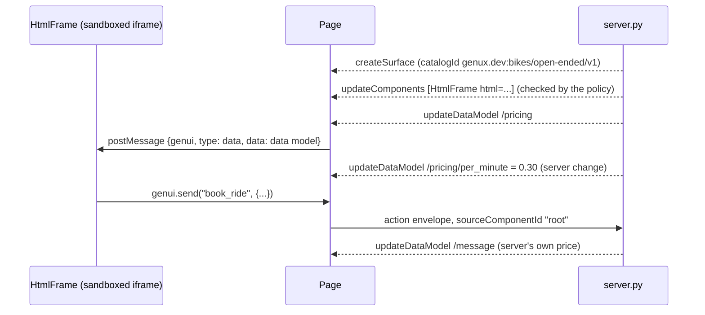
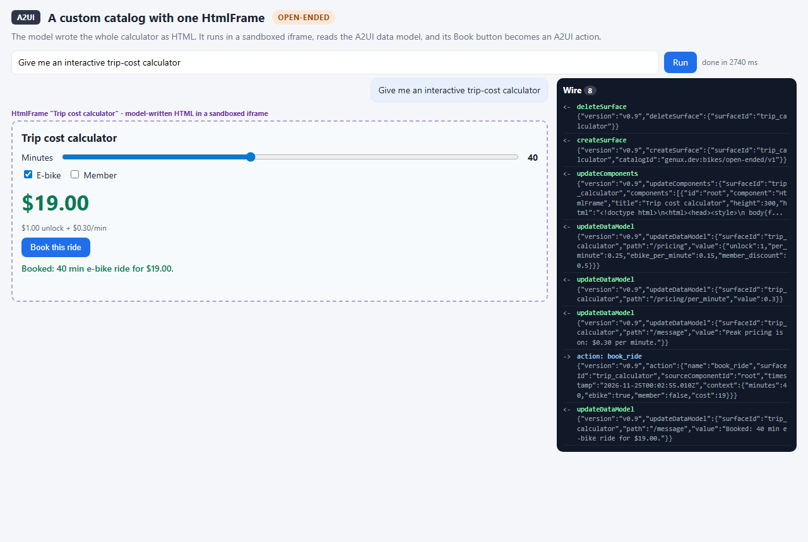

# A2UI · Open-ended: a custom catalog with one HtmlFrame

**Mode:** open-ended · **Run:** `python server.py` → http://127.0.0.1:8103 · **Demo:** `python demo.py`

The model is no longer limited to catalog layouts: it writes a complete HTML document (a trip-cost calculator) and wraps it in one `HtmlFrame` component. A2UI still carries it. Only the catalog changed: `createSurface` names a custom `catalogId` whose single component is a sandboxed document.

## What you will learn

- How A2UI's swappable catalogs make room for open-ended output without changing the protocol.
- The three layers that contain model-written HTML: a server-side content policy, a CSP, and `<iframe sandbox="allow-scripts">`.
- That open-ended does not mean disconnected: the A2UI data model still drives the generated view, and its buttons still produce A2UI actions.

## How it works



## Run it

```bash
python demo.py
python server.py      # http://127.0.0.1:8103
python -m pytest -q
```

## Recorded output

<!-- demo-output:start -->
```text

=== 1. What the model sent ===
  {"version":"v0.9","createSurface":{"surfaceId":"trip_calculator","catalogId":"genux.dev:bikes/open-ended/v1"}}
  updateComponents: 1 component, HtmlFrame with 2144 chars of HTML (705 tokens, tiktoken o200k_base)
  content policy violations: none
  {"version":"v0.9","updateDataModel":{"surfaceId":"trip_calculator","path":"/pricing","value":{"unlock":1.0,"per_minute":0.25,"ebike_per_minute":0.1...
  {"version":"v0.9","updateDataModel":{"surfaceId":"trip_calculator","path":"/pricing/per_minute","value":0.3}}
  {"version":"v0.9","updateDataModel":{"surfaceId":"trip_calculator","path":"/message","value":"Peak pricing is on: $0.30 per minute."}}

=== 2. The policy rejects what a sandbox should never see ===
   ['external <script src> is not allowed', 'network access (fetch) is not allowed', 'external URLs are not allowed']

=== 3. In the browser: server price change, then a booking from inside the iframe ===
  frame after updateDataModel: $1.00 unlock + $0.30/min | Peak pricing is on: $0.30 per minute.
  frame shows: $19.00 for 40 min on an e-bike
  server answer, shown inside the frame: Booked: 40 min e-bike ride for $19.00.
  iframe sandbox attribute: 'allow-scripts' (no allow-same-origin)
  saved demo.png
```
<!-- demo-output:end -->



## Code walkthrough

**1. A catalog with one component, and a policy check attached to it.**

`../_shared/htmlframe.py`:

```python
def policy(component: dict) -> list[str]:
    return [f"html: {problem}" for problem in check_html(component.get("html", ""))]


OPEN_CATALOG = a2ui.Catalog("genux.dev:bikes/open-ended/v1", {"HtmlFrame": HTML_FRAME}, {"HtmlFrame": policy})
```

**2. The policy is a list of things a sandboxed widget never needs.** A violation is returned like any validation error.

`../../../common/genui_common/sandbox.py`:

```python
    (re.compile(r"<script[^>]*\ssrc\s*=", re.I), "external <script src> is not allowed"),
...
    (re.compile(r"\bfetch\s*\(", re.I), "network access (fetch) is not allowed"),
```

**3. On the page, an HtmlFrame is a slot that the FrameHost fills with a sandboxed iframe.**

`../_shared/htmlframe.mjs`:

```js
  HtmlFrame(component, { frames }) {
    const label = `HtmlFrame "${component.title ?? component.id}" - model-written HTML in a sandboxed iframe`;
    return {
      el: frames.slot(component.id, component.html ?? '', { label, height: component.height ?? 280 }),
```

**4. The sandbox: opaque origin, injected CSP, one message shape.**

`../../../common/web/sandbox.mjs`:

```js
  frame.setAttribute('sandbox', 'allow-scripts');
...
    if (event.source !== frame.contentWindow) return; // only messages from this frame
    const message = event.data;
    if (!message || message.genui !== 1) return; // only the bridge's shape
```

**5. The server pushes data into the generated view, exactly as it would for a catalog component.**

`server.py`:

```python
    time.sleep(PEAK_DELAY)
    network.pricing["per_minute"] = 0.30
    yield a2ui.update_data_model(agent.SURFACE, "/pricing/per_minute", 0.30)
```

**6. The booking is priced by the server.** The frame's `cost` is only compared, never trusted.

`server.py`:

```python
    price = network.ride_cost(ctx["minutes"], ctx["ebike"], ctx["member"])  # the server's price, not the frame's
```

## What to notice

- The model's whole UI is one component of about 2,100 characters (see the token count). The same calculator as catalog components would not exist: the Basic Catalog has no slider.
- The iframe's `sandbox` attribute is `allow-scripts` only. Without `allow-same-origin`, the document cannot read the page, its cookies or its storage.
- The peak-price update arrives after the calculator is on screen, and the calculator recomputes: the data model is a live channel into generated UI.

## Try it yourself

1. Add `fetch('/steal')` to the scripted HTML in `agent.py`; the run now ends with a policy error and nothing is mounted.
2. Change `A2UI_PEAK_DELAY` to `5` and watch the price rule update five seconds after the calculator appears.
3. From the browser console, post a message to `window` that imitates the bridge. The page ignores it, because it did not come from the frame.
