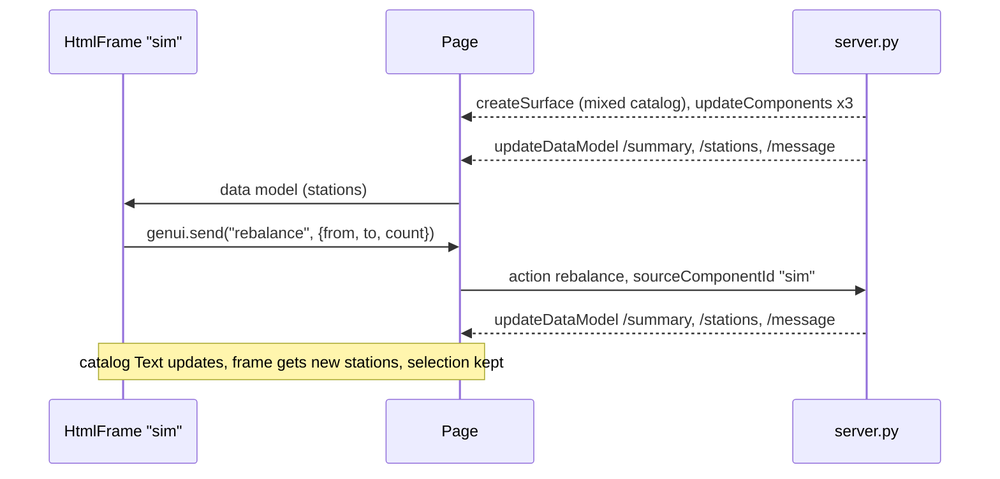
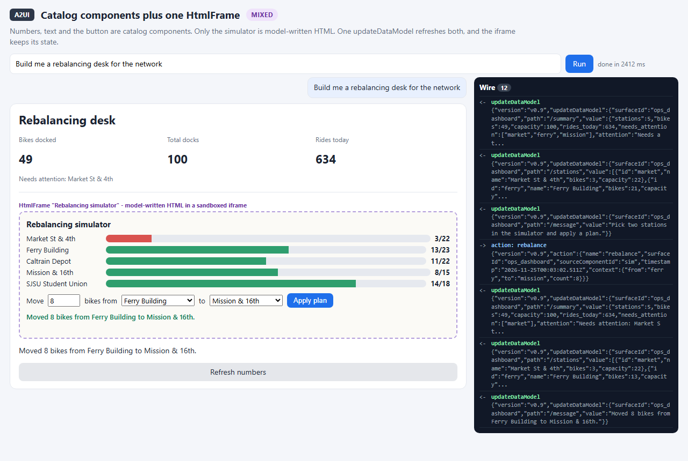

# A2UI · Mixed: catalog components plus one HtmlFrame

**Mode:** mixed · **Run:** `python server.py` → http://127.0.0.1:8104 · **Demo:** `python demo.py`

A rebalancing desk: the title, numbers, caption and button are Basic Catalog components; only the rebalancing simulator, which the catalog cannot express, is model-written HTML. Both halves read one data model, so one `updateDataModel` refreshes both, and the iframe keeps its state.

## What you will learn

- The hybrid rule in a prompt: catalog first, one generated region only where the catalog falls short.
- How one data model feeds catalog components and a sandboxed iframe at the same time.
- Why re-rendering must not move an iframe, and how `morph()` and `FrameHost` keep it in place.

## How it works



## Run it

```bash
python demo.py
python server.py      # http://127.0.0.1:8104
python -m pytest -q
```

## Recorded output

<!-- demo-output:start -->
```text

=== 1. What the model wrote: mostly catalog, one HtmlFrame ===
  createSurface: genux.dev:bikes/mixed/v1
  updateComponents: Card, Column, Text, Row, Column, Text, Text, Column, Text, Text, Column, Text, Text, Text, Divider
  updateComponents: HtmlFrame
  updateComponents: Text, Row, Text, Button
  updateDataModel: /summary
  updateDataModel: /stations
  updateDataModel: /message
  catalog components: 1642 chars; HtmlFrame: 3308 chars (66% of the layout for one interactive region)
  tokens: layout 1963 total (tiktoken o200k_base)

=== 2. In the browser: an action from inside the frame, then one from a catalog button ===
  before: Needs attention: Market St & 4th, Ferry Building, Mission & 16th
  catalog Text after the frame's action: Moved 8 bikes from Ferry Building to Mission & 16th.
  catalog Text now: Needs attention: Market St & 4th
  frame kept its selection: ferry -> mission
  saved demo.png
  after the catalog button: Numbers refreshed at 00:03:02 UTC.
  wire: action: rebalance, updateDataModel, updateDataModel, updateDataModel, action: refresh, updateDataModel, updateDataModel, updateDataModel
```
<!-- demo-output:end -->



## Code walkthrough

**1. The mixed catalog is the Basic Catalog plus HtmlFrame.**

`../_shared/htmlframe.py`:

```python
MIXED_CATALOG = a2ui.Catalog("genux.dev:bikes/mixed/v1", {**a2ui.BASIC, "HtmlFrame": HTML_FRAME}, {"HtmlFrame": policy})
```

**2. The prompt states the hybrid rule.**

`agent.py`:

```python
Rule: build everything you can from catalog components (Text, Row, Column, Card,
Button...). Use HtmlFrame only for a part the catalog cannot express, such as an
interactive simulation, and use at most one. Bind values to the data model:
```

**3. The server enforces "at most one" while the reply streams.**

`server.py`:

```python
        if a2ui.kind(message) == "updateComponents":
            frames += sum(c.get("component") == "HtmlFrame" for c in message["updateComponents"]["components"])
            if frames > 1:
                problems.append({"path": "/updateComponents", "message": "at most one HtmlFrame per surface"})
```

**4. Actions are bound to the component that may send them.** `rebalance` is accepted only from `sim`, `refresh` only from the catalog button. Capacity rules hold whatever the frame sends.

`server.py`:

```python
    elif act["name"] == "rebalance" and act["sourceComponentId"] == "sim":
        ids = {s["id"] for s in network.stations}
        if ctx.get("from") not in ids or ctx.get("to") not in ids or ctx.get("from") == ctx.get("to"):
```

**5. Re-render without reloading the iframe.** Each render rebuilds the tree, then `morph()` keeps every element whose key and signature did not change. Frame slots are opaque to it.

`../../../common/web/morph.mjs`:

```js
  if (a.dataset.sig !== b.dataset.sig) return b; // props changed: take the new element
  if (a.dataset.frame !== undefined || a.tagName === 'IFRAME') return a; // frames are opaque
```

**6. After every render, each frame receives the whole data model.**

`../_shared/render.mjs`:

```js
  render() {
    morph(this.container, [this.node('root', new Set())]);
    this.frames.attach(this.container, this.surface.data); // new frames mount; every frame gets the data model
  }
```

## What to notice

- The recorded output shows where the bytes go: the one interactive region is about two thirds of the layout.
- After the frame's action, the catalog caption changes from three stations to one, and the simulator still shows the same `from`/`to` selection: it was not reloaded.
- The server answers both actions with `updateDataModel` only. The layout never comes back.

## Try it yourself

1. Ask for a plan that breaks capacity (move 20 bikes into Mission & 16th) and read the "Not applied" message in both halves.
2. Add a second `HtmlFrame` to the scripted reply and see the server refuse it.
3. Replace the simulator with catalog components only. What can you no longer show?
