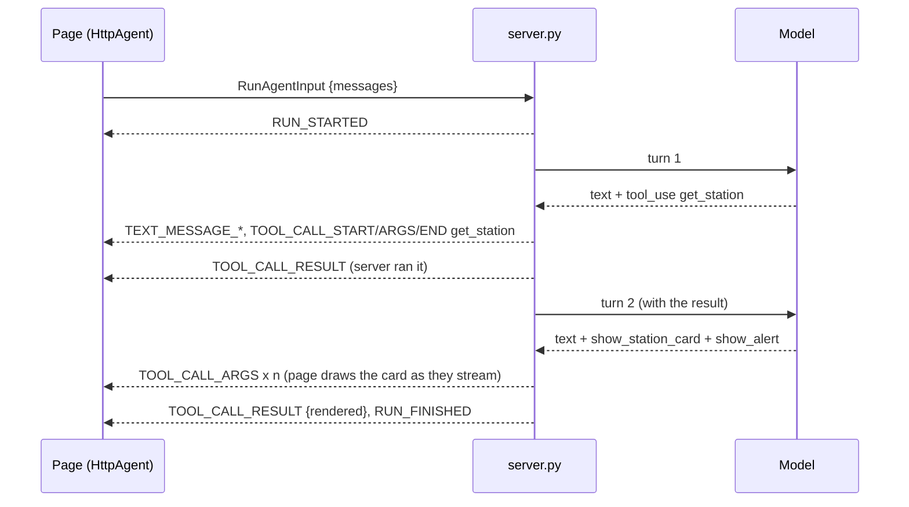
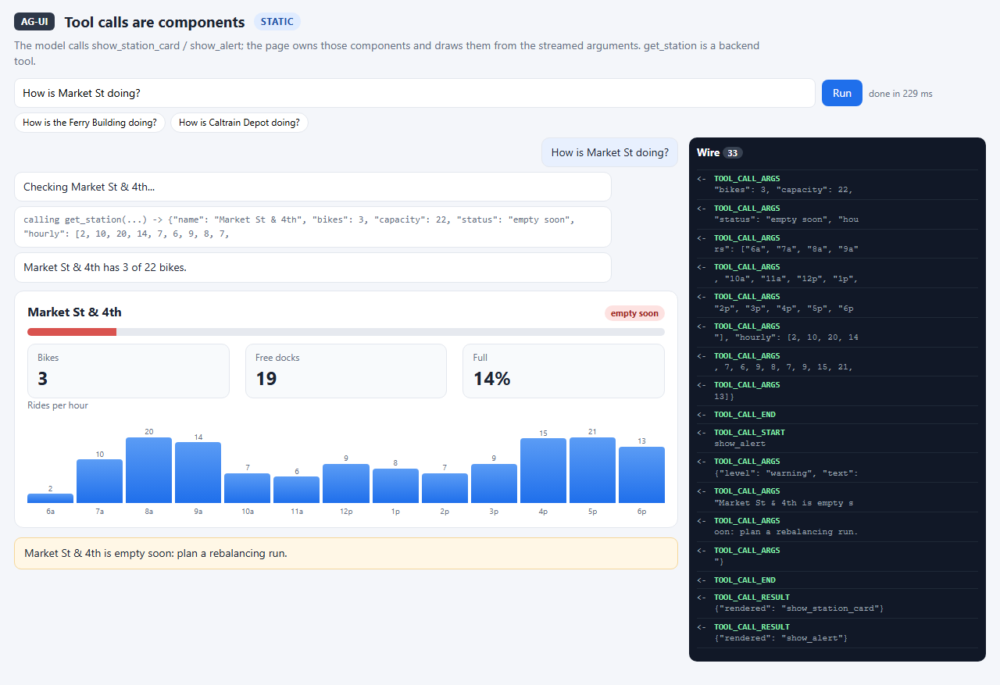

# AG-UI · Static: tool calls are components

**Mode:** static · **Run:** `python server.py` → http://127.0.0.1:8201 · **Demo:** `python demo.py`

The page owns two pre-built components, a station card and an alert. Each is exposed to the model as a tool. When the model "calls" one, AG-UI streams the call and the page renders the component while the arguments are still arriving. A third tool, `get_station`, is an ordinary backend tool: the server runs it and streams the answer as `TOOL_CALL_RESULT`.

## What you will learn

- A run's event sequence, from `RUN_STARTED` to `RUN_FINISHED`, on the wire.
- The difference between a backend tool (the server executes it) and a render tool (the page draws it).
- Progressive rendering of tool arguments with a tolerant partial-JSON parser.

## How it works



## Run it

```bash
python demo.py
python server.py      # http://127.0.0.1:8201
python -m pytest -q   # includes a conformance test against ag_ui.core
```

## Recorded output

<!-- demo-output:start -->
```text

=== 1. One run on the wire (RunAgentInput in, events out) ===
  RUN_STARTED            {'threadId': 't1', 'runId': 'r1'}
  TEXT_MESSAGE_START     {'messageId': 'msg_61d2cdabc3', 'role': 'assistant'}
  TEXT_MESSAGE_CONTENT   {'messageId': 'msg_61d2cdabc3', 'delta': 'Checking Market St & 4th...'}
  TEXT_MESSAGE_END       {'messageId': 'msg_61d2cdabc3'}
  TOOL_CALL_START        {'toolCallId': 'toolu_abb8f662e011', 'toolCallName': 'get_station', 'parentMessageId': 'msg_61d2cdabc3'}
  TOOL_CALL_ARGS x1 (the arguments, streamed as JSON fragments)
  TOOL_CALL_END          {'toolCallId': 'toolu_abb8f662e011'}
  TOOL_CALL_RESULT       {'messageId': 'msg_0105fdb9b7', 'toolCallId': 'toolu_abb8f662e011', 'role': 'tool', 'content': '{"name": "Mark
  TEXT_MESSAGE_START     {'messageId': 'msg_01504b64c6', 'role': 'assistant'}
  TEXT_MESSAGE_CONTENT   {'messageId': 'msg_01504b64c6', 'delta': 'Market St & 4th has 3 of 22 '}
  TEXT_MESSAGE_CONTENT   {'messageId': 'msg_01504b64c6', 'delta': 'bikes.'}
  TEXT_MESSAGE_END       {'messageId': 'msg_01504b64c6'}
  TOOL_CALL_START        {'toolCallId': 'toolu_c2c9c3355dd1', 'toolCallName': 'show_station_card', 'parentMessageId': 'msg_01504b64c6'}
  TOOL_CALL_ARGS x9 (the arguments, streamed as JSON fragments)
  TOOL_CALL_END          {'toolCallId': 'toolu_c2c9c3355dd1'}
  TOOL_CALL_START        {'toolCallId': 'toolu_7821a48eace9', 'toolCallName': 'show_alert', 'parentMessageId': 'msg_01504b64c6'}
  TOOL_CALL_ARGS x4 (the arguments, streamed as JSON fragments)
  TOOL_CALL_END          {'toolCallId': 'toolu_7821a48eace9'}
  TOOL_CALL_RESULT       {'messageId': 'msg_c2fa59af7a', 'toolCallId': 'toolu_c2c9c3355dd1', 'role': 'tool', 'content': '{"rendered": "
  TOOL_CALL_RESULT       {'messageId': 'msg_5c4e2eb0d8', 'toolCallId': 'toolu_7821a48eace9', 'role': 'tool', 'content': '{"rendered": "
  RUN_FINISHED           {'threadId': 't1', 'runId': 'r1'}

=== 2. In the browser: components drawn from tool calls ===
  show_station_card: Market St & 4th | empty soon | Bikes | 3 | Free docks | 19 | Full | 14% | Rides per hour | 2 | 6a | 10 | 7a | 20 | 8a | 
  show_alert: Market St & 4th is empty soon: plan a rebalancing run.
  saved demo.png
```
<!-- demo-output:end -->



## Code walkthrough

**1. Two kinds of tools.** The names say what the page will do with them.

`agent.py`:

```python
BACKEND_TOOLS = {"get_station"}
RENDER_TOOLS = {"show_station_card", "show_alert"}
```

**2. The run is a small agent loop.** Model events become AG-UI events; tool calls are executed or acknowledged; the loop stops once only render tools were called.

`server.py`:

```python
            for event, final in agui.model_events(llm, agent.SYSTEM, messages, agent.TOOLS):
                if event:
                    yield event
                else:
                    done = final
...
            if all(c["name"] in agent.RENDER_TOOLS for c in calls):
                break  # the UI is on screen; the model has nothing new to read
```

**3. Render tool arguments are validated too.** The page drew them, but the model reads the result, so a bad call comes back as an error it can fix.

`server.py`:

```python
    errors = [e.message for e in SCHEMAS[call["name"]].iter_errors(call["input"])]
    if errors:
        return json.dumps({"error": errors}), True
```

**4. On the page, the whole static catalog is a registry from tool name to component.**

`page/app.mjs`:

```js
const registry = {
  show_station_card: (args) => stationCard(args),
  show_alert: (args) => alert({ level: args.level, text: args.text ?? '' }),
};
```

**5. Each `TOOL_CALL_ARGS` re-renders from the partially parsed arguments.**

`page/app.mjs`:

```js
  TOOL_CALL_ARGS: (e) => draw(e.toolCallId), // progressive: partial JSON -> partial card
```

`../_shared/agui-client.mjs`:

```js
          call.args += event.delta;
          call.parsed = parsePartial(call.args); // streaming args: usable before they finish
```

## What to notice

- `TEXT_MESSAGE_END` always comes before `TOOL_CALL_START`: one message's events stay together.
- The card's arguments arrive in nine `TOOL_CALL_ARGS` fragments; the page draws after each one.
- The render tools still get a `TOOL_CALL_RESULT` (`{"rendered": ...}`), so the next run's history pairs every tool call with a result.

## Try it yourself

1. Add a `show_ride_quote` render tool: a schema in `agent.py` and a registry entry in `page/app.mjs`.
2. Make the scripted model send `"level": "panic"` and watch the error result.
3. Set `GENUI_DELAY=0.1` and watch the card fill in field by field.
