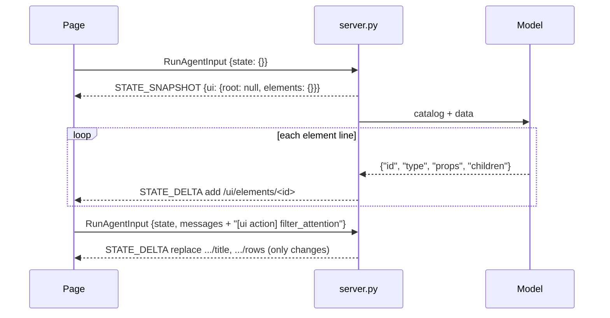
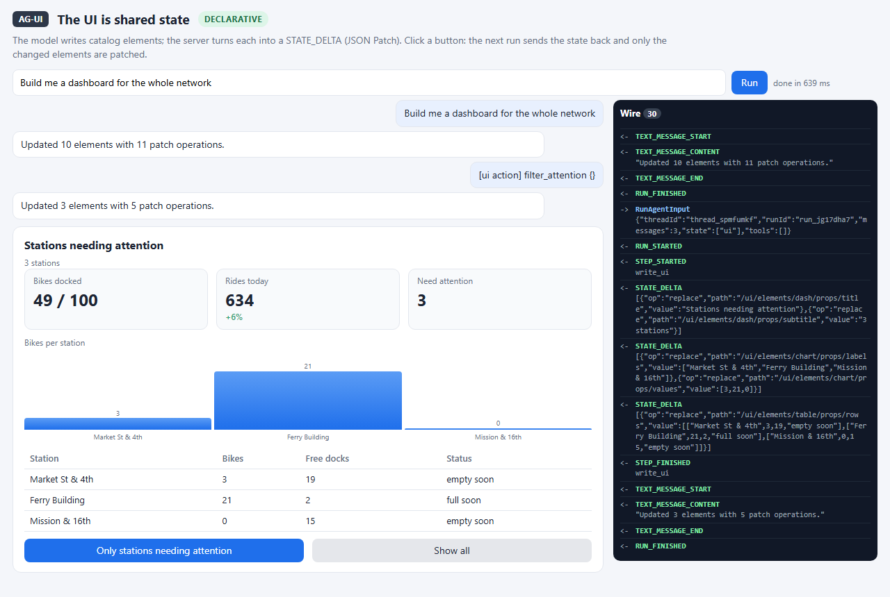

# AG-UI · Declarative: the UI is shared state

**Mode:** declarative · **Run:** `python server.py` → http://127.0.0.1:8202 · **Demo:** `python demo.py`

AG-UI has first-class shared state: `STATE_SNAPSHOT` sends all of it, `STATE_DELTA` sends JSON Patch operations. Here the state holds a declarative UI, a flat element map from a catalog. The model writes one element per line and each line becomes a `STATE_DELTA`, so the dashboard grows on screen while the model writes. On the next run the page sends the state back and only the elements that change are patched.

## What you will learn

- Generative UI as state: the page renders `agent.state.ui` after every state event.
- Snapshot versus delta, and why the second run is a fraction of the first on the wire.
- Who owns the state between runs (the page) and why the server re-validates it anyway.

## How it works



## Run it

```bash
python demo.py
python server.py      # http://127.0.0.1:8202
python -m pytest -q
```

## Recorded output

<!-- demo-output:start -->
```text

=== 1. First run: the UI is built in state, one element per delta ===
  STATE_SNAPSHOT  {"ui": {"root": null, "elements": {}}}
  STEP_STARTED    write_ui
  STATE_DELTA     replace /ui/root                             "dash"
  STATE_DELTA     add     /ui/elements/dash                    {"type": "Card", "props": {"title": "Network d
  STATE_DELTA     add     /ui/elements/kpis                    {"type": "Row", "props": {}, "children": ["m_b
  STATE_DELTA     add     /ui/elements/m_bikes                 {"type": "Metric", "props": {"label": "Bikes d
  STATE_DELTA     add     /ui/elements/m_rides                 {"type": "Metric", "props": {"label": "Rides t
  STATE_DELTA     add     /ui/elements/m_attention             {"type": "Metric", "props": {"label": "Need at
  STATE_DELTA     add     /ui/elements/chart                   {"type": "BarChart", "props": {"title": "Bikes
  STATE_DELTA     add     /ui/elements/table                   {"type": "Table", "props": {"columns": ["Stati
  STATE_DELTA     add     /ui/elements/actions                 {"type": "Row", "props": {}, "children": ["onl
  STATE_DELTA     add     /ui/elements/only_attention          {"type": "Button", "props": {"label": "Only st
  STATE_DELTA     add     /ui/elements/show_all                {"type": "Button", "props": {"label": "Show al
  STEP_FINISHED   write_ui
  RUN_FINISHED    {'elements': 10, 'rejected': 0}

=== 2. Second run: a button click sends the state back; only changes are patched ===
  STEP_STARTED    write_ui
  STATE_DELTA     replace /ui/elements/dash/props/title        "Stations needing attention"
  STATE_DELTA     replace /ui/elements/dash/props/subtitle     "3 stations"
  STATE_DELTA     replace /ui/elements/chart/props/labels      ["Market St & 4th", "Ferry Building", "Mission
  STATE_DELTA     replace /ui/elements/chart/props/values      [3, 21, 0]
  STATE_DELTA     replace /ui/elements/table/props/rows        [["Market St & 4th", 3, 19, "empty soon"], ["F
  STEP_FINISHED   write_ui
  RUN_FINISHED    {'elements': 3, 'rejected': 0}
  state bytes on the wire: first run 2573, second run 776

=== 3. In the browser ===
  title: Network dashboard | table rows: 5
  after the click: Stations needing attention | table rows: 3
  saved demo.png
```
<!-- demo-output:end -->



## Code walkthrough

**1. One element line becomes one patch.** A new element is an `add`; an element that already exists is a minimal diff.

`server.py`:

```python
    path = f"/ui/elements/{jsonpatch._escape(element_id)}"
    old = state["ui"]["elements"].get(element_id)
    ops = [{"op": "add", "path": path, "value": element}] if old is None else jsonpatch.diff(old, element, path)
```

**2. Every element is checked against the catalog before it becomes a patch.** A rejected element is reported as a `CUSTOM ui.rejected` event and never reaches state.

`server.py`:

```python
        errors = agent.CATALOG.check_element(element_id, element)
        if errors:
            rejected.append({"id": element_id, "errors": errors})
            yield agui.custom("ui.rejected", rejected[-1])
            continue
```

**3. The page sends its state back; the server does not trust it blindly.**

`server.py`:

```python
    state = run.state if isinstance(run.state.get("ui"), dict) else copy.deepcopy(EMPTY)
    if agent.CATALOG.check_spec(state["ui"]) and state["ui"]["elements"]:
        state = copy.deepcopy(EMPTY)  # the client sent something broken: start over
```

**4. The client applies deltas to its copy of the state.**

`../_shared/agui-client.mjs`:

```js
        case 'STATE_DELTA':
          this.state = applyPatch(this.state, event.delta);
          break;
```

**5. Rendering is one line per state event; a click starts the next run.**

`page/app.mjs`:

```js
const paint = () => view.render(agent.state.ui);
const handlers = { STATE_SNAPSHOT: paint, STATE_DELTA: paint };
```

## What to notice

- The first run is one snapshot plus eleven deltas; the second run is five `replace` operations and no snapshot. The recorded byte counts show the difference.
- The model in the second run wrote only three elements; `jsonpatch.diff` turned them into the smallest patch.
- The shared element renderer (`common/web/elements.mjs`) is the same one theme 04 and theme 06 use.

## Try it yourself

1. Change the "Show all" button to a new action, `sort_by_bikes`, and teach the scripted model to send a sorted table.
2. Tamper with `agent.state` in the browser console (add an element of type `Script`) and click a button: the server starts over.
3. Count the bytes of `STATE_DELTA` events in the wire panel for each run.
