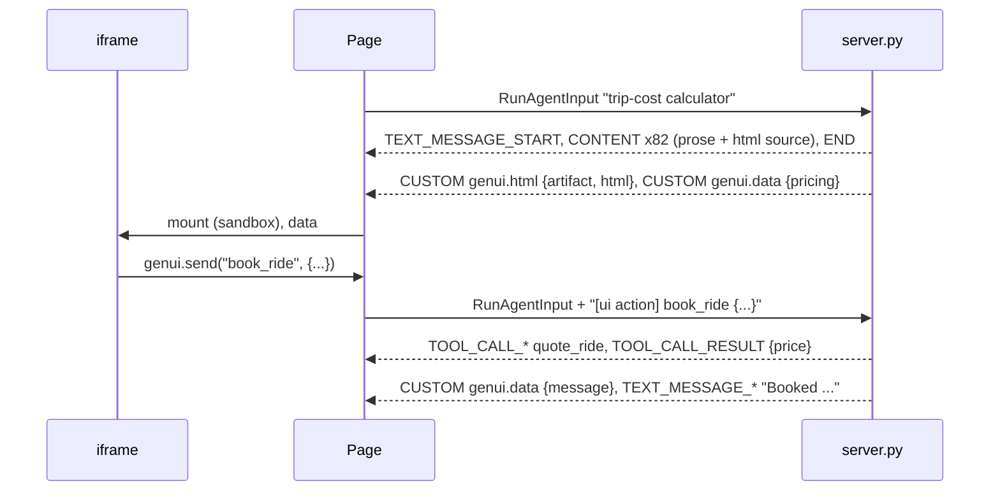
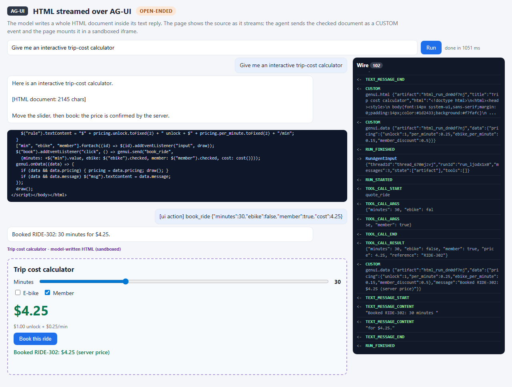

# AG-UI · Open-ended: HTML streamed over AG-UI

**Mode:** open-ended · **Run:** `python server.py` → http://127.0.0.1:8203 · **Demo:** `python demo.py`

There is no catalog. The model answers in text and puts a complete HTML document in a fenced html block. The text streams as `TEXT_MESSAGE_CONTENT` like any reply, and the page shows the source as it grows. When the fence closes, the agent checks the document and sends it once more as a `CUSTOM` event, `genui.html`, which the page mounts in a sandboxed iframe. Clicks inside the frame come back as user messages and start a new run.

## What you will learn

- How open-ended output travels on a transport that only knows text, tools, state and custom events.
- Why the agent, not the page, decides when a document is complete and safe (`CUSTOM genui.html` vs `genui.html.rejected`).
- How a generated view's action becomes a new run with a backend tool call and data pushed back into the frame.

## How it works



## Run it

```bash
python demo.py
python server.py      # http://127.0.0.1:8203
python -m pytest -q
```

## Recorded output

<!-- demo-output:start -->
```text

=== 1. Events of the first run (content deltas collapsed) ===
  RUN_STARTED          
  TEXT_MESSAGE_START   
  TEXT_MESSAGE_END     after 82 TEXT_MESSAGE_CONTENT events, 2269 chars (733 tokens)
  CUSTOM               genui.html artifact=html_r1 html=2145 chars
  CUSTOM               genui.data {"pricing": {"unlock": 1.0, "per_minute": 0.25, "ebike_per_minute": 0.
  RUN_FINISHED         

=== 2. A click inside the frame becomes a user message; a backend tool prices it ===
  TOOL_CALL_START      {"toolCallId": "toolu_8afd80e5449e", "toolCallName": "quote_ride", "parentMessageId": "msg_d8527c9d2c"}
  TOOL_CALL_RESULT     {"toolCallId": "toolu_8afd80e5449e", "role": "tool", "content": "{\"minutes\": 30, \"ebike\": false, \"member\
  CUSTOM               {"name": "genui.data", "value": {"artifact": "html_r1", "data": {"pricing": {"unlock": 1.0, "per_minute": 0.25
  TEXT_MESSAGE_CONTENT {"delta": "Booked RIDE-301: 30 minutes "}
  TEXT_MESSAGE_CONTENT {"delta": "for $4.25."}

=== 3. In the browser ===
  frame: $4.25 for 30 min as a member
  frame message: Booked RIDE-302: $4.25 (server price)
  chat: Booked RIDE-302: 30 minutes for $4.25.
  saved demo.png
```
<!-- demo-output:end -->



## Code walkthrough

**1. The agent watches its own reply for a complete document.**

`server.py`:

```python
                if event["type"] == "TEXT_MESSAGE_CONTENT":
                    reply += event["delta"]
                    match = FENCE.search(reply)
                    if match and not sent:  # the document is complete: check it, then ship it
                        sent = True
                        html = match.group(1)
                        problems = check_html(html)
```

**2. Custom events wait until the text message is closed.**

`server.py`:

```python
                if event["type"] == "TEXT_MESSAGE_END":
                    yield from pending  # CUSTOM events go out once the text message is closed
                    pending = []
```

**3. The page splits prose from source while the reply streams.**

`page/app.mjs`:

```js
function split(text) {
  const start = text.indexOf('```html');
  if (start < 0) return { prose: text, code: null };
```

**4. `CUSTOM genui.html` mounts the sandbox; `CUSTOM genui.data` feeds it.**

`page/app.mjs`:

```js
    if (e.name === 'genui.html') {
...
      mounts.set(e.value.artifact, mountSandbox(slot, e.value.html, { onAction, height: 300 }));
...
    } else if (e.name === 'genui.data') {
      mounts.get(e.value.artifact)?.send(e.value.data);
```

**5. A click inside the frame becomes a user message and a new run.**

`page/app.mjs`:

```js
async function onAction(name, payload) {
  const text = `[ui action] ${name} ${JSON.stringify(payload)}`;
  shell.say('user', text);
  agent.addUserMessage(text);
  await run(handlers);
```

**6. The price comes from a backend tool, not from the frame.**

`server.py`:

```python
def quote(args: dict) -> dict:
    price = network.ride_cost(args["minutes"], args["ebike"], args["member"])
    return {**args, "price": price, "reference": f"RIDE-{next(references)}"}
```

## What to notice

- The whole calculator is about 730 tokens of text output; compare with the static and declarative codelabs.
- The document travels twice: once as text (so the user sees it being written) and once as a checked artifact. Only the second one is ever executed.
- The model's reply to a click is an ordinary run: a backend tool call, then text.

## Try it yourself

1. Make the scripted HTML call `fetch()` and watch `CUSTOM genui.html.rejected` replace the iframe.
2. Add a second action, `reset`, to the calculator and handle it in the scripted model.
3. In `page/app.mjs`, mount the frame as soon as the fence closes in the text, without waiting for the custom event. What do you give up?
