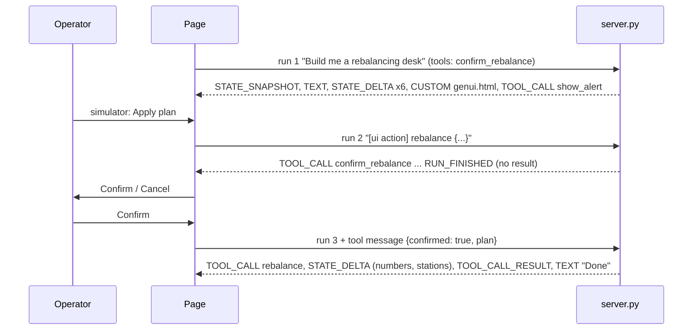
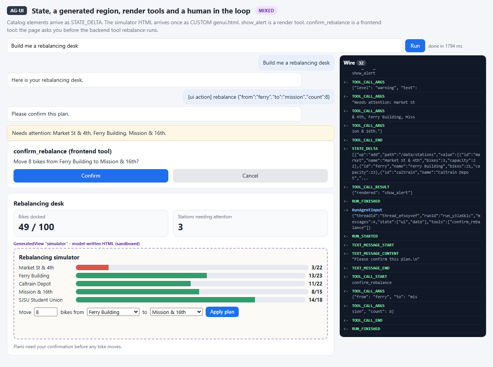
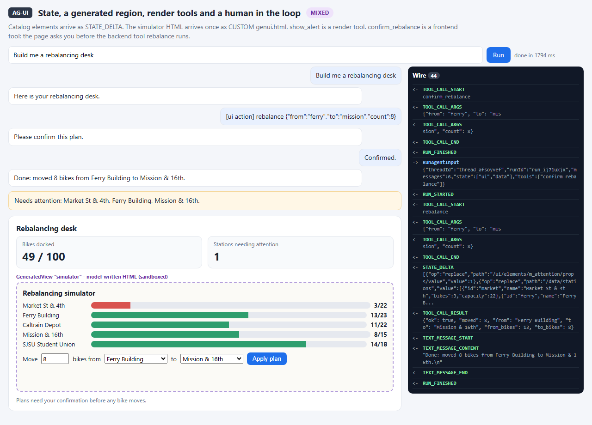

# AG-UI · Mixed: state, a generated region, render tools and a human in the loop

**Mode:** mixed · **Run:** `python server.py` → http://127.0.0.1:8204 · **Demo:** `python demo.py`

Every AG-UI mechanism in one rebalancing desk:

- **declarative:** catalog elements in shared state (`STATE_DELTA`);
- **open-ended:** one `GeneratedView` element whose HTML travels once as `CUSTOM genui.html`, not in state;
- **static:** a render tool, `show_alert`, drawn by a pre-built component;
- **human in the loop:** `confirm_rebalance` is a *frontend* tool. The page declares it in `RunAgentInput.tools`, the model calls it, the run ends, the operator answers, and the answer starts the next run. Only then does the backend tool `rebalance` move any bikes.

## What you will learn

- How the agent splits one model reply into chat text, state patches and an artifact.
- Why a large artifact belongs in a custom event and not in state (state goes back and forth on every run).
- The frontend-tool round trip: a tool call with no result, a page-side answer, a tool message in the next run.

## How it works



## Run it

```bash
python demo.py
python server.py      # http://127.0.0.1:8204
python -m pytest -q
```

## Recorded output

<!-- demo-output:start -->
```text

=== In the browser: build, act inside the frame, confirm, see state update ===
  run 1 events: RunAgentInput, RUN_STARTED, STATE_SNAPSHOT, TEXT_MESSAGE_START, TEXT_MESSAGE_CONTENT, TEXT_MESSAGE_END, STATE_DELTA, CUSTOM, TOOL_CALL_START, TOOL_CALL_ARGS, TOOL_CALL_END, TOOL_CALL_RESULT, RUN_FINISHED
  alert (render tool): Needs attention: Market St & 4th, Ferry Building, Mission & 16th.
  metric: Stations needing attention 3
  run 2 ended with a frontend tool call: confirm_rebalance (frontend tool) |  | Move 8 bikes from Ferry Building to Mission & 16th? |  | Confirm | Cancel
  saved demo_confirm.png
  run 3 reply: Done: moved 8 bikes from Ferry Building to Mission & 16th.
  metric now: Stations needing attention 1
  frame kept running; it shows: Market St & 4th 3/22 Ferry Building 13/23 Caltrain Depot 11/22 Mission & 16th 8/15 SJSU Student Union 14/18
  saved demo.png
```
<!-- demo-output:end -->

| Run 2 ends on the frontend tool | After the operator confirms |
|---|---|
|  |  |

## Code walkthrough

**1. One model reply, three destinations.** JSON lines become state or an artifact; everything else is chat.

`server.py`:

```python
                if text_line.strip().startswith("{"):
                    state, events = handle_line(state, text_line)
                    return close_chat() + events
```

`server.py`:

```python
    if "artifact" in item and "html" in item:
        problems = check_html(item["html"])
        if problems:
            return state, [agui.custom("genui.html.rejected", {"artifact": item["artifact"], "problems": problems})]
        return state, [agui.custom("genui.html", {"artifact": item["artifact"], "html": item["html"]})]
```

**2. A frontend tool ends the run.** The server routes tool calls by kind: render tools get a result here, backend tools run here, frontend tools are answered by the page.

`server.py`:

```python
            if not calls or any(c["name"] in frontend for c in calls):
                break  # nothing to run, or the page must answer a frontend tool first
```

**3. The page declares the frontend tool in every run.**

`page/app.mjs`:

```js
const FRONTEND_TOOLS = [{
  name: 'confirm_rebalance',
  description: 'Ask the operator to confirm a rebalancing plan. Returns {confirmed, plan}.',
```

**4. The operator's answer becomes a tool message, and the next run starts.**

`page/app.mjs`:

```js
    agent.addToolResult(call.id, { confirmed, plan: call.parsed });
    await go();
```

**5. After the backend tool runs, the application patches the numbers in state.**

`server.py`:

```python
    new["data"]["stations"] = stations()
    for element_id, value in (("m_bikes", f"{summary['bikes']} / {summary['capacity']}"),
                              ("m_attention", len(summary["needs_attention"]))):
```

**6. The GeneratedView element only names its artifact; the page looks the HTML up.**

`page/app.mjs`:

```js
  GeneratedView: (p, kids, ctx) =>
    ctx.frames.slot(p.artifact, artifacts.get(p.artifact) ?? '<p style="font:13px sans-serif">waiting for the artifact...</p>', {
```

## What to notice

- The state never contains the simulator's HTML (a test checks this); only `{"artifact": "simulator"}`.
- Run 2 ends with `RUN_FINISHED` right after `TOOL_CALL_END confirm_rebalance`: there is no `TOOL_CALL_RESULT` from the server.
- Cancel instead of Confirm, and the model says nothing moved; the network is unchanged.

## Try it yourself

1. Add a second frontend tool, `pick_station`, that shows a dropdown and returns a station id.
2. Put the artifact HTML into state instead of a custom event and compare the size of the next `RunAgentInput`.
3. Make the scripted model call `rebalance` without asking first. Which line in `server.py` would you add to forbid that?
