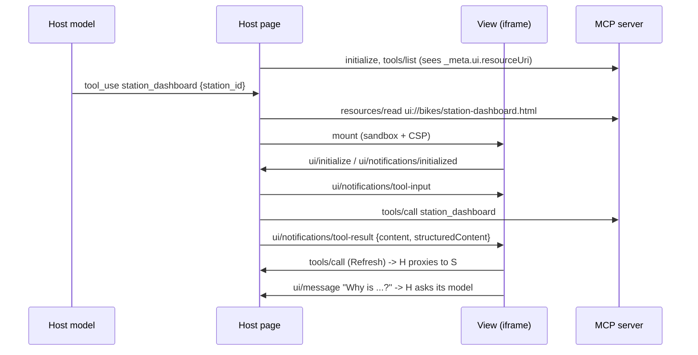
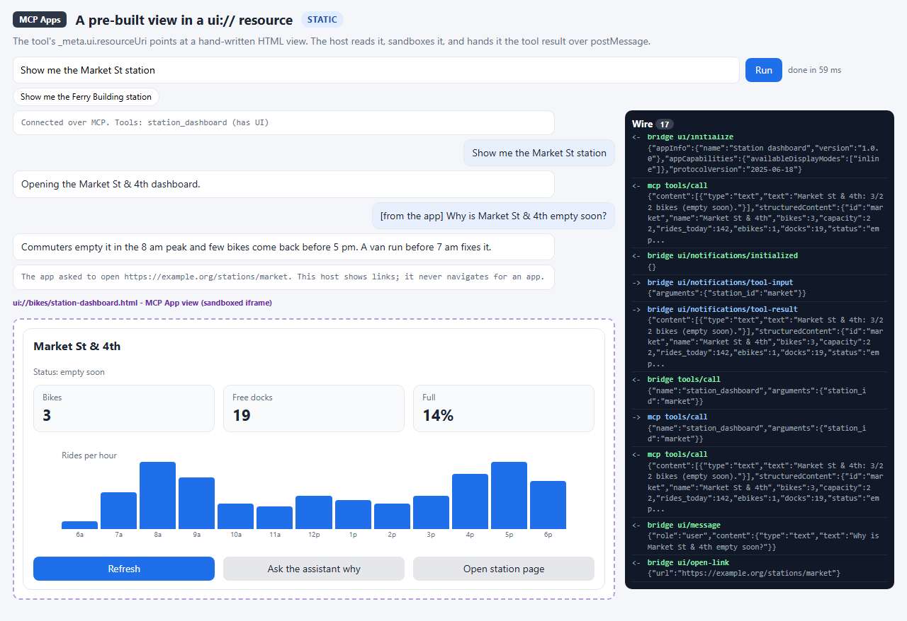

# MCP Apps · Static: a pre-built view in a ui:// resource

**Mode:** static · **Run:** `python server.py` → http://127.0.0.1:8301 (host page; MCP at `/mcp`) · **Demo:** `python demo.py`

A FastMCP server with one tool, `station_dashboard`. Its `_meta.ui.resourceUri` points at a hand-written HTML view: a static component. The host's model decides to call the tool; the host mounts the view and hands it the result. The view can refresh itself through `tools/call`, ask the host's model a question with `ui/message`, and ask the host to open a link.

## What you will learn

- The two pieces of metadata that turn an MCP tool into an MCP App.
- The bridge handshake (`ui/initialize` → `ui/notifications/initialized` → `tool-input` → `tool-result`) and who sends what.
- What a view may ask its host for, and what the host decides.

## How it works



## Run it

```bash
python demo.py
python server.py            # host page http://127.0.0.1:8301
python server.py --stdio    # for Claude Desktop / Goose / VS Code
python -m pytest -q         # includes a test with the official mcp ClientSession
```

## Recorded output

<!-- demo-output:start -->
```text

=== 1. What any MCP host sees ===
  initialize -> server bikes-static, protocol 2025-06-18, session a260d7a5...
  tools/list -> station_dashboard  _meta: {"ui": {"resourceUri": "ui://bikes/station-dashboard.html"}}
  resources/read -> text/html;profile=mcp-app, 11904 chars, _meta: {"ui": {"csp": {"connectDomains": [], "resourceDomains": []}, "prefersBorder": true}}
  tools/call -> content: 'Market St & 4th: 3/22 bikes (empty soon).'
               structuredContent keys: ['bikes', 'capacity', 'docks', 'ebikes', 'hourly', 'hours', 'id', 'name', 'rides_today', 'status']

=== 2. The demo host: model -> tool call -> view -> bridge ===
  view title: Market St & 4th
  chat:
    Connected over MCP. Tools: station_dashboard (has UI)
    Show me the Market St station
    Opening the Market St & 4th dashboard.
    [from the app] Why is Market St & 4th empty soon?
    Commuters empty it in the 8 am peak and few bikes come back before 5 pm. A van run before 7 am fixes it.
    The app asked to open https://example.org/stations/market. This host shows links; it never navigates for an ap
  bridge traffic: mcp initialize, mcp tools/list, mcp resources/read, mcp tools/call, bridge ui/initialize, bridge ui/notifications/initialized, bridge ui/notifications/tool-input, bridge ui/notifications/tool-result, bridge tools/call, bridge ui/message, bridge ui/open-link
  saved demo.png
```
<!-- demo-output:end -->



## Code walkthrough

**1. The tool points at its view; the result carries text for the model and data for the view.**

`server.py`:

```python
@mcp.tool(meta={"ui": {"resourceUri": VIEW_URI}})
def station_dashboard(station_id: str = "market") -> types.CallToolResult:
...
        content=[types.TextContent(type="text", text=f"{v['name']}: {v['bikes']}/{v['capacity']} bikes ({v['status']}).")],
        # structuredContent: what the view renders
        structuredContent={**v, "hours": bikes.HOURS},
```

**2. The view is a resource with the MCP Apps MIME type and a CSP declaration.** Empty lists mean no network at all.

`server.py`:

```python
@mcp.resource(VIEW_URI, name="station_dashboard_view", mime_type=mcp_app.MIME, meta=mcp_app.VIEW_META)
```

`../_shared/mcp_app.py`:

```python
VIEW_META = {"ui": {"csp": {"connectDomains": [], "resourceDomains": []}, "prefersBorder": True}}
```

**3. The view connects, then waits for the result.**

`view.html`:

```html
    app.on('ui/notifications/tool-result', (result) => render(result.structuredContent));
    app.connect({ name: 'Station dashboard', version: '1.0.0' });
```

**4. A view may call tools on its own server; the host proxies the call.**

`view.html`:

```html
      const result = await app.callServerTool('station_dashboard', { station_id: station.id });
```

**5. The host answers the bridge.** It returns its context on `ui/initialize`, proxies `tools/call`, feeds `ui/message` to its own model, and shows (never follows) links.

`../_shared/host/host.mjs`:

```js
      case 'ui/message': {
        const text = p.content?.text ?? '';
        shell.say('user', `[from the app] ${text}`);
        conversation.push({ role: 'user', content: text });
        this.respond(msg.id, {});
        return hostTurn();
      }
      case 'ui/open-link':
        shell.say('tool', `The app asked to open ${p.url}. This host shows links; it never navigates for an app.`);
```

**6. The host builds the iframe's CSP from the resource's declaration.**

`../_shared/host/host.mjs`:

```js
function cspFor(meta) {
  const csp = meta?.ui?.csp ?? {};
  const connect = ['connect-src', ...(csp.connectDomains?.length ? csp.connectDomains : ["'none'"])].join(' ');
```

## What to notice

- `tools/list` shows the `_meta`, and `resources/read` returns `text/html;profile=mcp-app`: any MCP host sees the same thing.
- The bridge traffic line lists every method in order: initialize, tool-input, tool-result, then the view's own requests.
- A host without MCP Apps support would show only `Market St & 4th: 3/22 bikes (empty soon).` The text `content` is the fallback.

## Try it yourself

1. Add `"connectDomains": ["https://api.example.org"]` to `VIEW_META` and read the CSP the host builds.
2. Add a second tool without `_meta.ui`; the host shows its text result as a chat line.
3. Run `python server.py --stdio` from a real MCP host and compare with the demo host.
