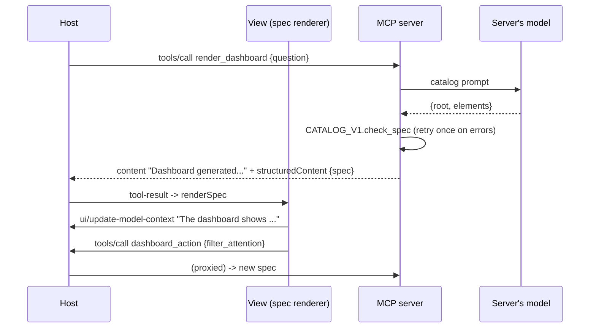
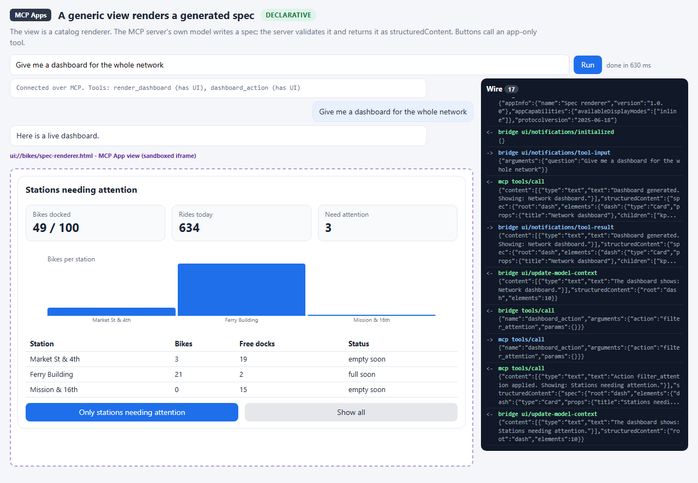

# MCP Apps · Declarative: a generic view renders a generated spec

**Mode:** declarative · **Run:** `python server.py` → http://127.0.0.1:8302 · **Demo:** `python demo.py`

The view is a catalog renderer, not a dashboard. The MCP server asks *its own* model for a declarative spec (a flat element map), validates it, and returns it as `structuredContent`. The model key stays on the server; the host's model only reads the text summary. Buttons in the spec call `dashboard_action`, an app-only tool the host hides from its model.

## What you will learn

- How one fixed `ui://` resource can render any validated spec.
- Where the server-side model fits: inside the tool, behind validation, invisible to the host.
- `_meta.ui.visibility` for app-only tools, and `ui/update-model-context` to keep the host's model informed without sending a chat message.

## How it works



## Run it

```bash
python demo.py
python server.py            # http://127.0.0.1:8302
python -m pytest -q
```

## Recorded output

<!-- demo-output:start -->
```text

=== 1. tools/list and one tools/call ===
  render_dashboard   _meta={"ui": {"resourceUri": "ui://bikes/spec-renderer.html"}}
  dashboard_action   _meta={"ui": {"visibility": ["app"]}}
  content (for the host's model): 'Dashboard generated. Showing: Network dashboard.'
  structuredContent.spec: root=dash, 10 elements, types=['BarChart', 'Button', 'Card', 'Metric', 'Row', 'Table']

=== 2. In the host: the view draws the spec, a button calls an app-only tool ===
  view: Network dashboard | rows: 5
  after the button: Stations needing attention | rows: 3
  model context recorded by the host: [{"type":"text","text":"The dashboard shows: Stations needing attention."}]
  saved demo.png
```
<!-- demo-output:end -->



## Code walkthrough

**1. The tool calls the server's model and validates its spec.** Errors go back to that model once.

`server.py`:

```python
    for _ in range(attempts):
        reply, _done = reply_text(spec_llm.stream(SPEC_SYSTEM, messages))
        try:
            spec = json.loads(reply)
            errors = CATALOG_V1.check_spec(spec)
```

**2. App-only tools.** A host that supports visibility hides `dashboard_action` from its model; the view may still call it.

`server.py`:

```python
@mcp.tool(meta={"ui": {"visibility": ["app"]}})
def dashboard_action(action: str, params: dict | None = None) -> types.CallToolResult:
```

**3. The view knows the catalog, not the dashboard.**

`view.html`:

```html
      renderSpec(root, spec, { onAction: press });
      const title = spec.elements[spec.root]?.props?.title;
      // Tell the host's model what the user is looking at, without sending a message.
      app.updateModelContext(`The dashboard shows: ${title}.`, { root: spec.root, elements: Object.keys(spec.elements).length });
```

**4. The renderer in the view kit walks the element map.**

`../_shared/view-kit.js`:

```js
  function renderSpec(container, spec, { onAction, custom = {} } = {}) {
    const node = (id, seen = new Set()) => {
      const el = spec.elements?.[id];
      if (!el || seen.has(id)) return h('div', { class: 'k-muted' }, `missing: ${id}`);
```

**5. The host enforces visibility on both sides.**

`../_shared/host/host.mjs`:

```js
        if (!visibleTo(tools.find((t) => t.name === p.name), 'app')) return this.fail(msg.id, `tool ${p.name} is not available to apps`);
```

## What to notice

- The host's model receives `Dashboard generated. Showing: Network dashboard.` It never sees the 10-element spec.
- After the button, the view re-renders from a new spec; the host records the new model context.
- The same view would render any spec the catalog allows: the dashboard lives in the server, not in the view.

## Try it yourself

1. Add a `Badge` per station to the spec in `spec_respond`; the view renders it without changes.
2. Make the scripted spec model return an unknown type on its first try and watch `generate_spec` retry.
3. Remove `visibility` from `dashboard_action` and check whether the host's model can now call it.
