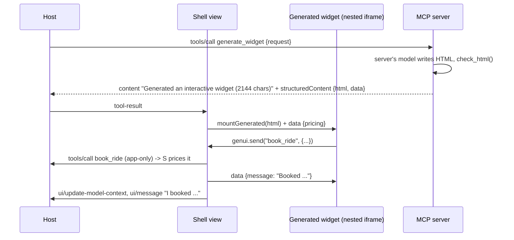
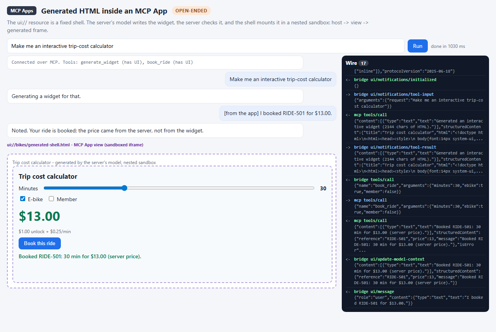

# MCP Apps · Open-ended: generated HTML inside an MCP App

**Mode:** open-ended · **Run:** `python server.py` → http://127.0.0.1:8303 · **Demo:** `python demo.py`

The server's model writes a whole widget (a trip-cost calculator). Why not publish it as a new `ui://` resource per answer? The tool declares its `resourceUri` up front, and hosts may fetch and cache that resource before any call. So the resource is a small fixed **shell**, and the generated document travels in `structuredContent`. The shell mounts it in a *nested* sandbox: host page → view iframe → generated iframe. Two boundaries.

## What you will learn

- Why the `ui://` resource stays fixed and the generated part rides in the tool result.
- A nested sandbox, and the content policy that runs on the server before anything leaves it.
- An app-only tool for the widget's action, plus `ui/update-model-context` and `ui/message` back to the host.

## How it works



## Run it

```bash
python demo.py
python server.py            # http://127.0.0.1:8303
python -m pytest -q
```

## Recorded output

<!-- demo-output:start -->
```text

=== 1. The fixed shell and the generated widget ===
  ui:// shell: 11533 chars (fetched once, cacheable)
  generated widget: 2144 chars, 705 tokens (tiktoken o200k_base) in structuredContent
  content for the host's model: 'Generated an interactive widget (2144 chars of HTML).'

=== 2. In the host: two sandboxes deep, a booking, a message back to the chat ===
  widget shows: $13.00
  widget message: Booked RIDE-501: 30 min for $13.00 (server price).
  host chat: [from the app] I booked RIDE-501 for $13.00. | Noted. Your ride is booked; the price came from the server, not from t
  sandbox attributes: allow-scripts / allow-scripts
  saved demo.png
```
<!-- demo-output:end -->



## Code walkthrough

**1. The policy runs on the server, before the HTML is returned.**

`server.py`:

```python
def generate_html(request: str) -> str:
    html, _done = reply_text(html_llm.stream(HTML_SYSTEM, [{"role": "user", "content": request}]))
    html = html.strip().removeprefix("```html").removesuffix("```").strip()
    problems = check_html(html)
    if problems:
        raise ValueError("generated HTML failed the content policy: " + "; ".join(problems))
```

**2. The widget travels in `structuredContent`; the host's model reads a one-line summary.**

`server.py`:

```python
        content=[types.TextContent(type="text", text=f"Generated an interactive widget ({len(html)} chars of HTML).")],
        structuredContent={"title": "Trip cost calculator", "html": html, "data": {"pricing": network.pricing}})
```

**3. The shell mounts it in a nested sandbox.**

`view.html`:

```html
      widget = mountGenerated(document.getElementById('slot'), html, { onAction, height: 300 });
      widget.send(data);
```

`../_shared/view-kit.js`:

```js
    const frame = h('iframe', { sandbox: 'allow-scripts', class: 'k-generated', title: 'generated region' });
```

**4. The shell decides which widget actions exist, and relays them to an app-only tool.**

`view.html`:

```html
      if (name !== 'book_ride') return; // the shell decides which widget actions exist
      const result = await app.callServerTool('book_ride', { minutes: payload.minutes, ebike: payload.ebike, member: payload.member });
```

**5. The server prices the ride itself.**

`server.py`:

```python
    price = network.ride_cost(minutes, ebike, member)
```

## What to notice

- The shell resource contains no widget; a test checks it. The resource can be cached forever.
- Both iframes carry `sandbox="allow-scripts"` only (printed in the output).
- The host's chat shows `[from the app] I booked RIDE-...` and the host model's answer: the app talked to the conversation without the user typing.

## Try it yourself

1. Make the scripted HTML model return a document with `<script src="https://...">`; the tool result becomes an error and nothing mounts.
2. Pass `cost` from the widget to `book_ride` and compare it with the server's price.
3. Replace `ui/message` with `ui/update-model-context` only. What does the host's chat show now?
