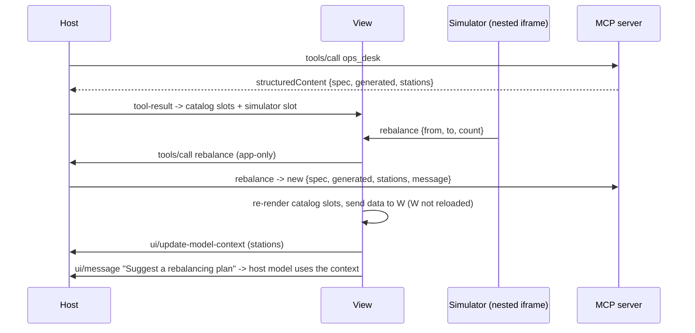
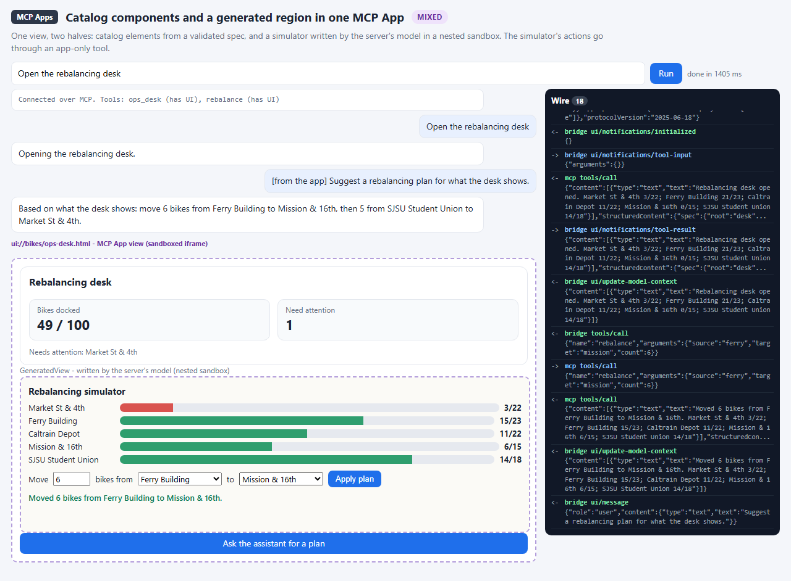

# MCP Apps · Mixed: catalog components and a generated region in one view

**Mode:** mixed · **Run:** `python server.py` → http://127.0.0.1:8304 · **Demo:** `python demo.py`

`ops_desk` returns `structuredContent` with three parts: a validated catalog `spec` (one element of which is a `GeneratedView`), the `generated` HTML for that region (written by the server's model and checked), and the `stations` both halves render. The simulator's action goes through `rebalance`, an app-only tool; the server enforces capacity and answers with a new result, which the view uses to update both halves.

## What you will learn

- How one MCP App view combines a declarative catalog part with an open-ended region.
- How to keep a nested iframe alive across updates (each top-level region has its own slot).
- `ui/update-model-context` as the channel that lets the host's model answer questions about the app's state.

## How it works



## Run it

```bash
python demo.py
python server.py            # http://127.0.0.1:8304
python -m pytest -q
```

## Recorded output

<!-- demo-output:start -->
```text

=== 1. One tool result, three parts ===
  spec: 9 catalog elements, 825 chars
  generated: ['simulator'], 3225 chars
  stations: ['market', 'ferry', 'caltrain', 'mission', 'sjsu']

=== 2. In the host: act inside the nested frame, then ask the host's model ===
  catalog half: Rebalancing desk | Bikes docked | 49 / 100 | Need attention | 3 |  | Needs attention: Market St & 4th, Ferry Building, Mission & 16th
  after the frame's action: Rebalancing desk | Bikes docked | 49 / 100 | Need attention | 1 |  | Needs attention: Market St & 4th
  simulator message: Moved 6 bikes from Ferry Building to Mission & 16th. | selection kept: ferry
  host model, with the app's context: Based on what the desk shows: move 6 bikes from Ferry Building to Mission & 16th, then 5 from SJSU Student Uni
  saved demo.png
```
<!-- demo-output:end -->



## Code walkthrough

**1. Catalog first: the spec has one GeneratedView and the rest are validated catalog elements.**

`server.py`:

```python
        "sim": {"type": "GeneratedView", "props": {"artifact": "simulator", "height": 250}},
```

**2. The tool result carries the three parts.**

`server.py`:

```python
                                structuredContent={"spec": s, "generated": {"simulator": html}, "stations": stations(),
                                                   "message": message})
```

**3. The view gives each top-level region its own slot.** Catalog slots re-render; the generated slot mounts once and only receives data.

`view.html`:

```html
        if (element.type === 'GeneratedView') {
          if (!frames.has(id)) {
...
          frames.get(id).send({ stations: data.stations, message: data.message });
        } else {
          renderSpec(slots.get(id), { root: id, elements: spec.elements }, { onAction: catalogAction });
```

**4. The simulator's action is relayed to an app-only tool; capacity is enforced on the server.**

`server.py`:

```python
@mcp.tool(meta={"ui": {"visibility": ["app"]}})
def rebalance(source: str, target: str, count: int) -> types.CallToolResult:
    """App-only: move bikes between stations (capacity is enforced here)."""
    result = network.rebalance(source, target, count)
```

**5. The host folds the latest model context into its next model turn.**

`../_shared/host/host.mjs`:

```js
  if (context && last?.role === 'user' && typeof last.content === 'string') {
    last.content = `[app context: ${(context.content ?? []).map((c) => c.text).join(' ')}]\n${last.content}`;
  }
```

## What to notice

- After the frame's action, the catalog half changes from three stations needing attention to one, and the simulator keeps its selection.
- The plan the host's model suggests is based on the app's context, not on anything the user typed.
- Spec and generated region are sized separately in the output: the generated region is most of the bytes.

## Try it yourself

1. Move the GeneratedView inside the header Card. What does the view have to do differently to keep the iframe alive?
2. Make `rebalance` model-visible too and let the host's model apply its own plan.
3. Add a `Table` of stations to the spec; it updates on every action without touching the simulator.
