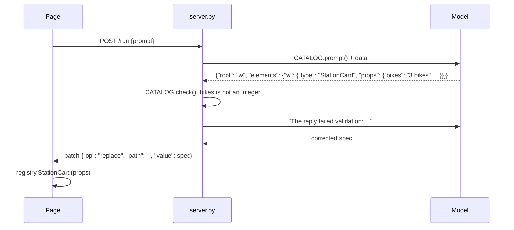
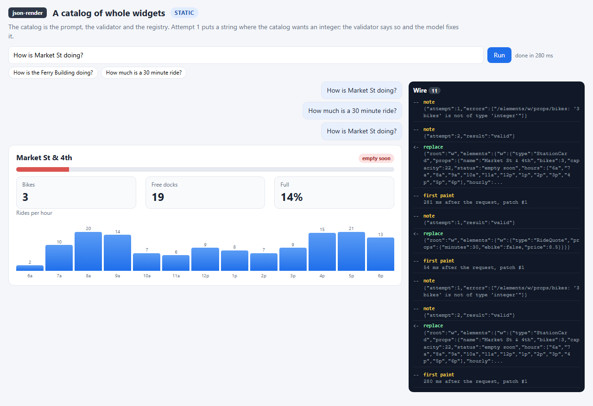

# json-render · Static: a catalog of whole widgets

**Mode:** static · **Run:** `python server.py` → http://127.0.0.1:8401 · **Demo:** `python demo.py`

The catalog has three pre-built widgets (`StationCard`, `AlertBanner`, `RideQuote`) and no layout primitives, so a spec is exactly one element: the model chooses a widget and fills its props. The same catalog writes the prompt, validates the reply, and names the components the browser registry draws.

## What you will learn

- json-render's central idea: one catalog, used as prompt, validator and registry.
- What a validator error looks like when it goes back to the model, and how the second attempt fixes it.
- That "static" in json-render is a catalog design choice: coarse widgets instead of primitives.

## How it works



## Run it

```bash
python demo.py
python server.py      # http://127.0.0.1:8401
python -m pytest -q
```

## Recorded output

<!-- demo-output:start -->
```text

=== 1. Use 1 - the catalog as the prompt ===
  Components (props; '?' = optional; bind any prop to state with {"$state": "/path"}):
  - StationCard(name, bikes, capacity, status?, hours?, hourly?): Everything about one station, with
  an hourly chart.
  - AlertBanner(level, text): One warning sentence.
  - RideQuote(minutes, ebike?, price): The price of one ride.
  Actions (use in "on": {"press": {"action": name, "params": {...}}}):
  - setState(statePath, value): Built in: set statePath to value, in the browser.

=== 2. Use 2 - the catalog as the validator ===
  {"note":{"attempt":1,"errors":["/elements/w/props/bikes: '3 bikes' is not of type 'integer'"]}}
  {"note":{"attempt":2,"result":"valid"}}
  patch replace '' -> one StationCard with props ['bikes', 'capacity', 'hourly', 'hours', 'name', 'status']

=== 3. Use 3 - the catalog as the registry (browser) ===
  rendered: Market St & 4th | empty soon | Bikes | 3 | Free docks | 19 | Full | 14% | Rides per hour | 2 | 6a | 
  second prompt rendered: Ride quote | 30 min | $8.50
  saved demo.png
```
<!-- demo-output:end -->



## Code walkthrough

**1. The catalog: components with JSON Schema props, and actions.**

`agent.py`:

```python
CATALOG = Catalog(
    components={
        "StationCard": {"description": "Everything about one station, with an hourly chart.",
                        "props": {"name": S, "bikes": I, "capacity": I, "status": S,
```

**2. Use 1: the prompt is generated from it.**

`../_shared/catalog.py`:

```python
        for name, c in self.components.items():
            sig = ", ".join(f"{p}{'' if p in c.get('required', []) else '?'}" for p in c["props"])
            lines.append(f"- {name}({sig}){' + children' if c.get('children') else ''}: {c['description']}")
```

**3. Use 2: the same catalog validates the reply.** Unknown types, wrong prop types, extra props and unknown actions are all reported with a path.

`../_shared/catalog.py`:

```python
        errors = [f"{where}/props/{'/'.join(map(str, e.path))}: {e.message}"
                  for e in self._props[element["type"]].iter_errors(element.get("props", {}))]
```

**4. Static mode adds one rule: exactly one widget.**

`server.py`:

```python
            if len(spec.get("elements", {})) != 1:
                errors.append("static mode: exactly one widget")
```

**5. Use 3: the registry maps the same names to DOM.**

`../_shared/registry.mjs`:

```js
  StationCard: (p) => w.stationCard(p),
  AlertBanner: (p) => w.alert({ level: p.level, text: p.text }),
```

## What to notice

- Attempt 1 fails with `'3 bikes' is not of type 'integer'`, and the model's second attempt sends `3`.
- The whole page is replaced by one patch with path `""` because the reply is a complete spec. Theme step 02 streams instead.
- Changing a prop name in the catalog changes the prompt, the validator and the registry lookup together; nothing drifts.

## Try it yourself

1. Add a `WeatherNote` widget to the catalog and the registry; ask about the weather.
2. Add `"html": "<b>"` to a widget's props in the scripted reply and read the "Additional properties" error.
3. Ask "How much is a 30 minute ride?" and see `RideQuote` chosen instead.
