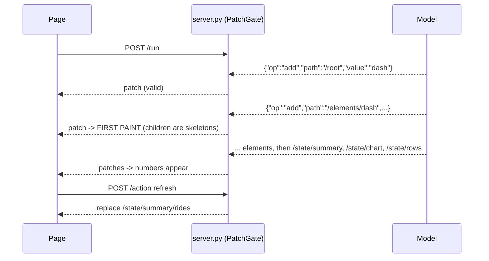
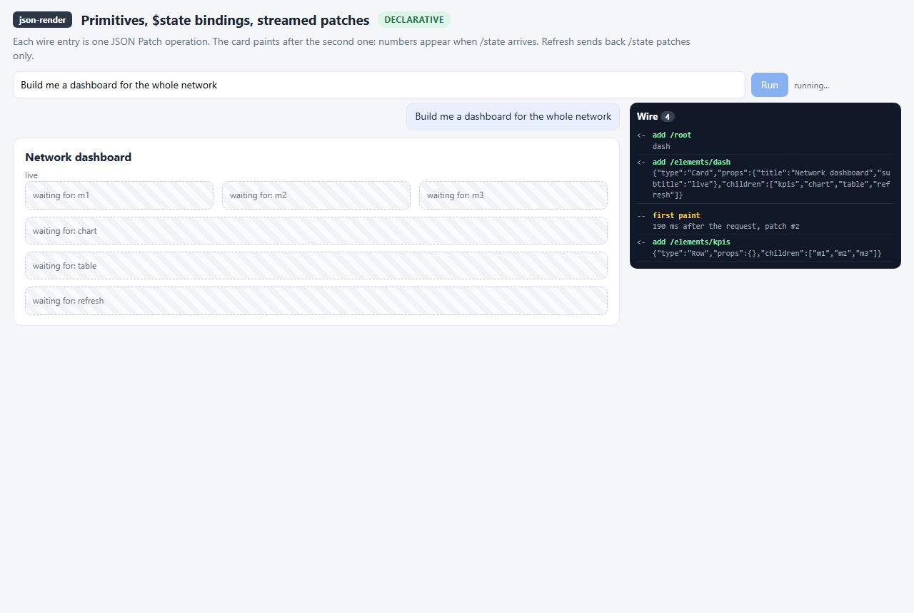
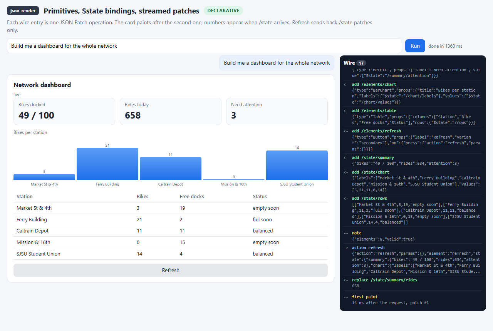

# json-render · Declarative: primitives, $state bindings, streamed patches

**Mode:** declarative · **Run:** `python server.py` → http://127.0.0.1:8402 · **Demo:** `python demo.py`

The catalog now holds layout primitives (Card, Row, Metric, BarChart, Table, Button). The model composes them and streams the spec as JSON Patch lines, so the page paints the frame first and fills it in. Values bind to `/state` with `{"$state": "/path"}`: a later patch to state updates every bound element, and the Refresh action is answered with state patches only.

## What you will learn

- SpecStream: one RFC 6902 operation per line, applied as soon as the line is complete.
- First paint versus complete render, measured in the browser.
- Why binding props to state makes updates small: the server never resends an element to change a number.

## How it works



## Run it

```bash
python demo.py
python server.py      # http://127.0.0.1:8402
python -m pytest -q
```

## Recorded output

<!-- demo-output:start -->
```text

=== 1. The patch stream ===
   1. add /root              "dash"
   2. add /elements/dash     {"type": "Card", "props": {"title": "Network dashboard", "subtitle": "...
   3. add /elements/kpis     {"type": "Row", "props": {}, "children": ["m1", "m2", "m3"]}
   4. add /elements/m1       {"type": "Metric", "props": {"label": "Bikes docked", "value": {"$stat...
   5. add /elements/m2       {"type": "Metric", "props": {"label": "Rides today", "value": {"$state...
   6. add /elements/m3       {"type": "Metric", "props": {"label": "Need attention", "value": {"$st...
   7. add /elements/chart    {"type": "BarChart", "props": {"title": "Bikes per station", "labels":...
   8. add /elements/table    {"type": "Table", "props": {"columns": ["Station", "Bikes", "Free dock...
   9. add /elements/refresh  {"type": "Button", "props": {"label": "Refresh", "variant": "secondary...
  10. add /state/summary     {"bikes": "49 / 100", "rides": 634, "attention": 3}
  11. add /state/chart       {"labels": ["Market St & 4th", "Ferry Building", "Caltrain Depot", "Mi...
  12. add /state/rows        [["Market St & 4th", 3, 19, "empty soon"], ["Ferry Building", 21, 2, "...
  first paint needs patches 1-2 (225 of 1837 chars, 12% of the stream)

=== 2. Refresh: state patches only ===
  patch: replace /state/summary/rides 646

=== 3. In the browser (slowed down so first paint is visible) ===
  saved demo_first_paint.png
  first paint 190 ms, complete 1360 ms, 12 patches
  Rides today 634 -> Rides today 658 (a /state patch, no element resent)
  saved demo.png
```
<!-- demo-output:end -->

| First paint (patch 2 of 12) | Complete, after Refresh |
|---|---|
|  |  |

## Code walkthrough

**1. The model writes patches top-down, and binds numbers to state.**

`agent.py`:

```python
        {"op": "add", "path": "/root", "value": "dash"},
        el("dash", "Card", {"title": "Network dashboard", "subtitle": "live"}, ["kpis", "chart", "table", "refresh"]),
...
        el("m1", "Metric", {"label": "Bikes docked", "value": {"$state": "/summary/bikes"}}),
```

**2. The server forwards an operation only if the gate accepts it.**

`server.py`:

```python
        errors = gate.offer(op)
        if errors:
            yield ("refused", {"op": op, "errors": errors})
        else:
            yield ("patch", op)
```

**3. The page applies each patch, re-renders, and records first paint.**

`../_shared/client.mjs`:

```js
      if (event === 'patch') {
        view.spec = applyOp(view.spec, data);
        timing.patches += 1;
        shell.log('in', `${data.op} ${data.path}`, data.value);
        view.render();
```

**4. Bindings resolve against state at render time.**

`../_shared/spec.mjs`:

```js
export function resolve(value, state) {
  if (value && typeof value === 'object' && !Array.isArray(value)) {
    if (typeof value.$state === 'string') return getPointer(state, value.$state);
```

**5. Refresh is answered with a diff of state, never with elements.**

`server.py`:

```python
    new_state = agent.state(network)
    for op in jsonpatch.diff(gate.spec["state"], new_state, "/state"):
```

**6. The library-style stream compiler, for clients that parse raw text.**

`../_shared/stream.mjs`:

```js
export function createSpecStreamCompiler(initial = { root: null, elements: {}, state: {} }) {
```

## What to notice

- First paint needs 2 of 12 patches, about an eighth of the stream (printed in the output). A complete JSON spec could only paint at the very end.
- Refresh produced a single `replace /state/summary/rides` operation.
- The gate refuses an unknown component, an unknown action and a prototype path (see the tests).

## Try it yourself

1. Move the `/state/...` patches before the elements in `ops()`. Does first paint change? Does the first paint look better?
2. Bind the card's subtitle to `/state/summary/rides` and watch it change on Refresh.
3. Add `"on": {"press": {"action": "launch_rockets"}}` to the Refresh button and read the refusal.
