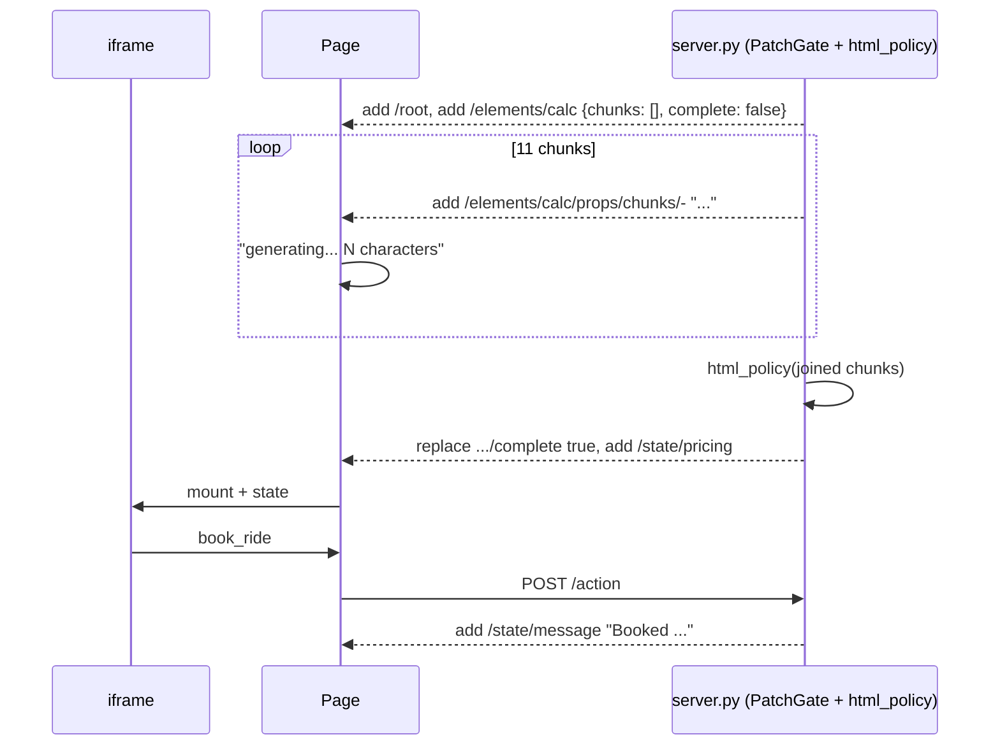
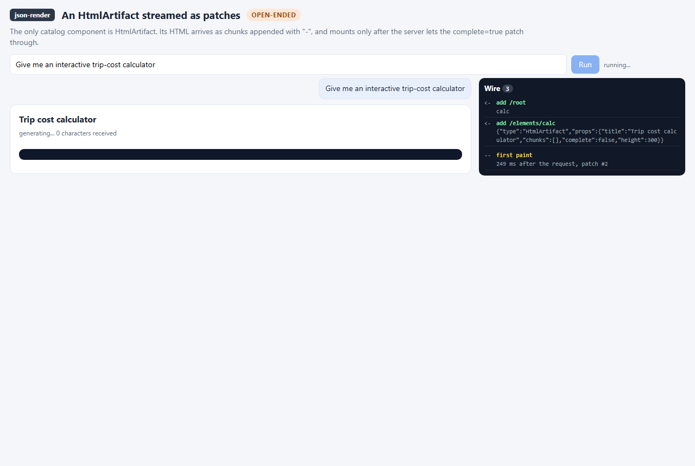
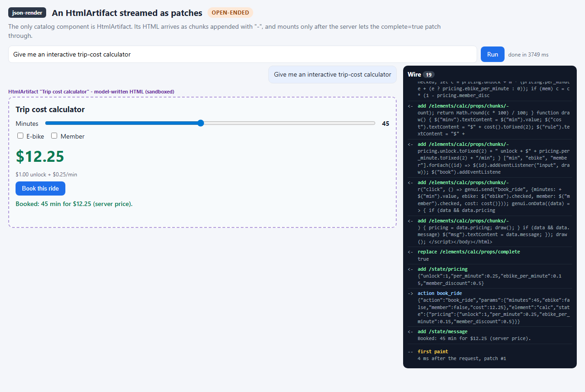

# json-render · Open-ended: an HtmlArtifact streamed as patches

**Mode:** open-ended · **Run:** `python server.py` → http://127.0.0.1:8403 · **Demo:** `python demo.py`

The model still speaks json-render (patches into an element map), but the catalog's only component is `HtmlArtifact`. JSON Patch cannot append to a string, so the document streams as an array of chunks: each chunk is `{"op": "add", "path": "/elements/calc/props/chunks/-", "value": "..."}`. The page shows progress while chunks arrive and mounts the document only when the model sets `props.complete` to true, which the server allows only after checking the whole document.

## What you will learn

- How to stream a long string through JSON Patch with array appends (`"-"`).
- A gate that runs the HTML content policy at the moment of completion, so a bad document never mounts.
- How an artifact's action comes back as a `/state` patch that the sandboxed document displays.

## How it works



## Run it

```bash
python demo.py
python server.py      # http://127.0.0.1:8403
python -m pytest -q
```

## Recorded output

<!-- demo-output:start -->
```text

=== 1. The stream: a document in chunks ===
  add     /root                                "calc"
  add     /elements/calc                       {"type": "HtmlArtifact", "props": {"title": "Trip cost c
  add     /elements/calc/props/chunks/-        "<!doctype html>\n<html><head><style>\n  body{font:14px 
  ...     (10 more chunk patches)              ""
  replace /elements/calc/props/complete        true
  add     /state/pricing                       {"unlock": 1.0, "per_minute": 0.25, "ebike_per_minute": 
  11 chunks, 2144 characters of HTML

=== 2. The gate: a document that fails the policy never completes ===
  /root                        -> accepted
  /elements/x                  -> accepted
  /elements/x/props/complete   -> ['/elements/x: network access (fetch) is not allowed']

=== 3. In the browser ===
  saved demo_streaming.png
  frame message (from a /state patch): Booked: 45 min for $12.25 (server price).
  saved demo.png
```
<!-- demo-output:end -->

| While chunks stream | Mounted and booked |
|---|---|
|  |  |

## Code walkthrough

**1. The document is appended in chunks, then marked complete.**

`agent.py`:

```python
           *[{"op": "add", "path": "/elements/calc/props/chunks/-", "value": html[i:i + 200]} for i in range(0, len(html), 200)],
           {"op": "replace", "path": "/elements/calc/props/complete", "value": True},
```

**2. The policy runs when the element claims to be complete.**

`agent.py`:

```python
    props = element.get("props", {})
    if not props.get("complete"):
        return []
    return [f"/elements/{element_id}: {p}" for p in check_html("".join(props.get("chunks", [])))]
```

**3. The registry shows progress, then a sandbox slot.**

`../_shared/registry.mjs`:

```js
    const html = (p.chunks ?? []).join('');
    if (!p.complete) {
...
    return ctx.frames.slot(ctx.id, html, { label: `HtmlArtifact "${p.title ?? ctx.id}" - model-written HTML (sandboxed)`, height: p.height ?? 280 });
```

**4. A booking is answered with one state patch; the frame receives the new state.**

`server.py`:

```python
    op = {"op": "add", "path": "/state/message", "value": message}
    if not session["gate"].offer(op):
        yield ("patch", op)
```

## What to notice

- The gate output in section 2: the root and the element are accepted, the `complete` patch is refused with `network access (fetch) is not allowed`.
- The artifact's props never change after completion, so the iframe is never re-created; only state flows into it.
- The same chunked-append trick works for any long text a spec needs to stream.

## Try it yourself

1. Change the chunk size to 50 and compare the number of patches and the progress display.
2. Send `complete: true` before the last chunk in the scripted reply. What does the page show?
3. Add a `reset` action to the calculator and answer it with a `/state/message` patch.
