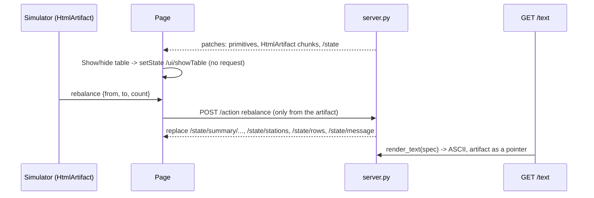
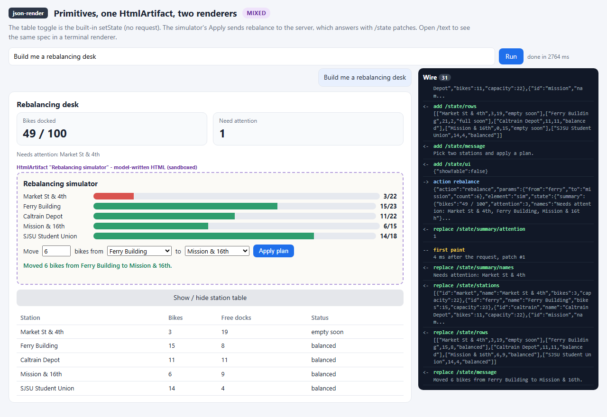

# json-render · Mixed: primitives, one HtmlArtifact, two renderers

**Mode:** mixed · **Run:** `python server.py` → http://127.0.0.1:8404 (and `/text`) · **Demo:** `python demo.py`

A rebalancing desk built from catalog primitives plus one `HtmlArtifact` for the simulator. Two kinds of action meet here: the table toggle uses the built-in `setState`, which runs in the browser and never reaches the server; the simulator's `rebalance` goes to the server and comes back as `/state` patches, which update the catalog elements and the artifact alike. The same spec is then rendered a second way: as text for a terminal.

## What you will learn

- Local actions (`setState`) versus server actions, and what each costs.
- "One spec, many renderers": a terminal renderer that resolves the same bindings and degrades the artifact to a pointer.
- That browser-only state stays in the browser: the terminal's copy of `/ui/showTable` is still false.

## How it works



## Run it

```bash
python demo.py
python server.py                          # http://127.0.0.1:8404
curl http://127.0.0.1:8404/text           # the terminal renderer, after a run
python -m pytest -q
```

## Recorded output

<!-- demo-output:start -->
```text

=== 1. In the browser: setState (local) and rebalance (server) ===
  table visible before toggle: False
  table visible after toggle: True | requests caused by setState: 0
  patches from the action: replace /state/summary/names, replace /state/stations, replace /state/rows, replace /state/message
  catalog metric: Need attention: 1 | frame: Moved 6 bikes from Ferry Building to Mission & 16th.
  saved demo.png

=== 2. The same spec in the terminal renderer (GET /text) ===
+-- Rebalancing desk --------------------------------------------------
    Bikes docked: 49 / 100
    Need attention: 1
  Needs attention: Market St & 4th
  [interactive: Rebalancing simulator - 3052 chars of HTML; open the web view to use it]
  [ Show / hide station table ]  -> setState
  (Table table hidden)
```
<!-- demo-output:end -->



## Code walkthrough

**1. A local action: `setState` with a `$not` toggle, and an element whose visibility is bound to state.**

`agent.py`:

```python
        el("toggle", "Button", {"label": "Show / hide station table", "variant": "secondary"},
           on={"press": {"action": "setState", "params": {"statePath": "/ui/showTable",
                                                           "value": {"$not": {"$state": "/ui/showTable"}}}}}),
```

**2. `setState` runs in the browser and never makes a request.**

`../_shared/spec.mjs`:

```js
    if (handler.action === 'setState') { // built in: no server, no model
      this.spec.state = setPointer(structuredClone(this.spec.state ?? {}), resolved.statePath, resolved.value);
      this.render();
      return undefined;
    }
```

**3. A server action is accepted only from the artifact, and answered with state patches.**

`server.py`:

```python
    if body.get("action") != "rebalance" or gate.spec["elements"].get(body.get("element"), {}).get("type") != "HtmlArtifact":
        yield ("error", {"message": "only the simulator may send rebalance"})
        return
```

**4. The second renderer resolves the same bindings and degrades what it cannot run.**

`render_text.py`:

```python
        elif kind == "HtmlArtifact":
            size = len("".join(p.get("chunks", [])))
            lines.append(f"{pad}[interactive: {p.get('title', element_id)} - {size} chars of HTML; open the web view to use it]")
```

## What to notice

- The toggle caused zero requests (counted from the server's request log in the output).
- The terminal render shows the table as hidden: `setState` changed the browser's state only. Decide deliberately which state is local.
- The artifact is the one part of the spec a terminal cannot use; everything else renders in both places.

## Try it yourself

1. Render the `BarChart` primitive in the spec and check its ASCII form at `/text`.
2. Make the toggle a server action instead of `setState` and compare the wire panel.
3. Write a third renderer (Markdown) in `render_text.py`'s style.
