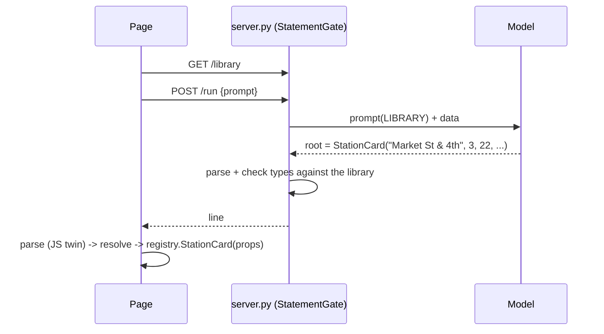
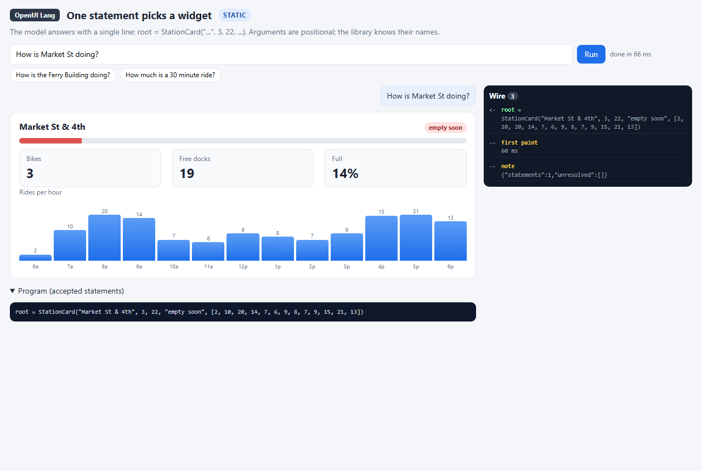

# OpenUI Lang · Static: one statement picks a widget

**Mode:** static · **Run:** `python server.py` → http://127.0.0.1:8501 · **Demo:** `python demo.py`

The library holds three whole widgets. The model's entire answer is one line, for example `root = StationCard("Market St & 4th", 3, 22, "empty soon", [2, 10, ...])`: it chooses the widget and fills its positional arguments. Positional arguments are why OpenUI Lang is compact: parameter names live in the library, not in every reply.

## What you will learn

- The shape of an OpenUI Lang statement and how positional arguments map to named props.
- How a library generates the prompt and type-checks each statement.
- What one widget costs in OpenUI Lang, as a tool call, and as a json-render spec.

## How it works



## Run it

```bash
python demo.py
python server.py      # http://127.0.0.1:8501
python -m pytest -q
```

## Recorded output

<!-- demo-output:start -->
```text

=== 1. The prompt the library generates ===
  Write OpenUI Lang: one statement per line, `id = Expression`. The first statement is `root = ...`.
  Capitalised calls are components with positional arguments; lowercase names refer to other
  statements and may refer forward. Literals are JSON. Components:
  - StationCard(name: string, bikes: number, capacity: number, status?: string, hourly?: list) -
  Everything about one station, with its hourly rides.
  - AlertBanner(level: 'info'|'warning'|'critical', text: string) - One warning sentence.
  - RideQuote(minutes: number, price: number) - The price of one ride.

=== 2. The answer: one line ===
  root = StationCard("Market St & 4th", 3, 22, "empty soon", [2, 10, 20, 14, 7, 6, 9, 8, 7, 9, 15, 21, 13])
  resolved props: {"name": "Market St & 4th", "bikes": 3, "capacity": 22, "status": "empty soon", "hourly": [2, 10, 20, 14, 7, 6 ...

=== 3. The same widget in other formats ===
  OpenUI Lang                 105 chars   61 tokens
  tool call (AG-UI static)    176 chars   86 tokens
  json-render spec            204 chars   98 tokens
  (tiktoken o200k_base)

=== 4. In the browser ===
  rendered: Market St & 4th | empty soon | Bikes | 3 | Free docks | 19 | Full | 14% | Rides per hour |
  saved demo.png
```
<!-- demo-output:end -->



## Code walkthrough

**1. The library: names and the order of positional parameters.**

`server.py`:

```python
    "StationCard": {"description": "Everything about one station, with its hourly rides.",
                    "params": [p("name", "string"), p("bikes", "number"), p("capacity", "number"),
                               p("status", "string", optional=True), p("hourly", "list", optional=True)]},
```

**2. The prompt shows positional signatures.**

`../_shared/openui.py`:

```python
        params = ", ".join(f"{x['name']}{'?' if x['optional'] else ''}: {'|'.join(map(repr, x['enum'])) if x.get('enum') else x['type']}"
                           for x in spec["params"])
```

**3. The gate checks every call against the library.** References are skipped here; they are checked once the stream ends.

`../_shared/openui.py`:

```python
        for param, arg in zip(params, args):
            if arg[0] == "ref":
                continue  # resolved later; may point forward
            if not CHECKS[param["type"]](arg):
                errors.append(f"{where}: {name}.{param['name']} must be {param['type']}")
```

**4. Positional arguments become named props when resolved.**

`../_shared/openui-parse.mjs`:

```js
    const params = (library[name]?.params ?? []).map((p) => p.name);
    const props = {};
    args.forEach((a, i) => { props[params[i] ?? `arg${i}`] = value(a, `${path}.${i}`, seen); });
```

## What to notice

- The recorded comparison: the same widget is about 60 tokens in OpenUI Lang, about 85 as a tool call and about 100 as a json-render spec (tiktoken `o200k_base`). The savings are the property names.
- The gate rejects `StationCard("A", "three", 5)` (`bikes must be number`) and `AlertBanner("panic", ...)` (enum).
- The page re-parses the accepted line with the JavaScript twin; both parsers agree (tests run both).

## Try it yourself

1. Reorder `bikes` and `capacity` in the library. What happens to an old program? (Positional formats trade robustness for size.)
2. Add an optional `delta` parameter to `RideQuote` and use it in the scripted answer.
3. Ask for a station that does not exist and see which widget the scripted model falls back to.
