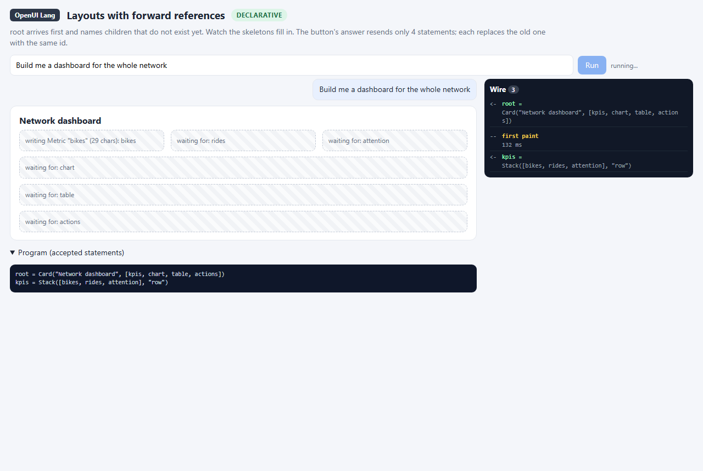
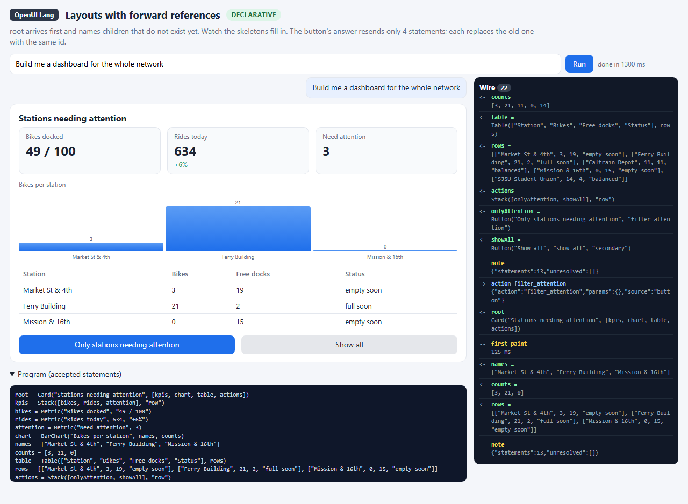

# OpenUI Lang · Declarative: layouts with forward references

**Mode:** declarative · **Run:** `python server.py` → http://127.0.0.1:8502 · **Demo:** `python demo.py`

The model writes `root` first and names children that do not exist yet. The page paints that frame at once (skeletons for missing ids, and "writing Metric ..." for the statement currently streaming) and fills it in line by line. A button action asks the model again; it answers with only the statements that change, and each replaces the old one by id.

## What you will learn

- Forward references: why writing `root` first gives the earliest possible first paint.
- Incremental updates by redefinition, with no patch format at all.
- How OpenUI Lang's size compares with an element-map JSON spec for the same UI.

## How it works

```mermaid
sequenceDiagram
    participant P as Page
    participant S as server.py
    participant M as Model
    M-->>S: root = Card("Network dashboard", [kpis, chart, table, actions])
    S-->>P: line -> paint: 4 skeletons
    M-->>S: kpis = Stack([bikes, rides, attention], "row")
    S-->>P: line + pending {id: bikes, component: Metric}
    M-->>S: ... 11 more lines
    P->>S: POST /action filter_attention
    S->>M: current program + "[ui action] filter_attention"
    M-->>S: root = Card("Stations needing attention", ...), names = [...], counts = [...], rows = [...]
    S-->>P: 4 lines; each replaces its statement
```

## Run it

```bash
python demo.py
python server.py      # http://127.0.0.1:8502
python -m pytest -q
```

## Recorded output

<!-- demo-output:start -->
```text

=== 1. The program, as it streams ===
  root = Card("Network dashboard", [kpis, chart, table, actions])    missing now: kpis, chart, table, actions
  kpis = Stack([bikes, rides, attention], "row")                     missing now: bikes, rides, attention, chart, table, actions
  bikes = Metric("Bikes docked", "49 / 100")                         missing now: rides, attention, chart, table, actions
  rides = Metric("Rides today", 634, "+6%")                          missing now: attention, chart, table, actions
  attention = Metric("Need attention", 3)                            missing now: chart, table, actions
  chart = BarChart("Bikes per station", names, counts)               missing now: names, counts, table, actions
  names = ["Market St & 4th", "Ferry Building", "Caltrain Depot",    missing now: counts, table, actions
  counts = [3, 21, 11, 0, 14]                                        missing now: table, actions
  table = Table(["Station", "Bikes", "Free docks", "Status"], rows   missing now: rows, actions
  rows = [["Market St & 4th", 3, 19, "empty soon"], ["Ferry Buildi   missing now: actions
  actions = Stack([onlyAttention, showAll], "row")                   missing now: onlyAttention, showAll
  onlyAttention = Button("Only stations needing attention", "filte   missing now: showAll
  showAll = Button("Show all", "show_all", "secondary")              missing now: -

=== 2. Size next to an element-map JSON spec of the same UI ===
  OpenUI Lang         881 chars   282 tokens
  json-render spec   1369 chars   454 tokens  (tiktoken o200k_base)

=== 3. An action: only changed statements come back ===
  root = Card("Stations needing attention", [kpis, chart, table, actions])
  names = ["Market St & 4th", "Ferry Building", "Mission & 16th"]
  counts = [3, 21, 0]
  rows = [["Market St & 4th", 3, 19, "empty soon"], ["Ferry Building", 21, 2, "full soon"], ["Mission 

=== 4. In the browser ===
  saved demo_streaming.png
  after the action: Stations needing attention | table rows: 3
  saved demo.png
```
<!-- demo-output:end -->

| Mid-stream: forward references as skeletons | After the button's 4-statement update |
|---|---|
|  |  |

## Code walkthrough

**1. The program, root first.**

`server.py`:

```python
        "root": f'root = Card("{title}", [kpis, chart, table, actions])',
        "kpis": "kpis = Stack([bikes, rides, attention], \"row\")",
```

**2. Streaming: complete lines are returned; the unfinished line waits, and reports what it is about to define.**

`../_shared/openui-parse.mjs`:

```js
  feed(chunk) {
    this.buffer += chunk;
    const done = [];
    let index;
    while ((index = this.buffer.indexOf('\n')) >= 0) {
```

**3. A missing reference renders as a skeleton, or as progress when that statement is streaming.**

`../_shared/render.mjs`:

```js
  if (node.type === '__missing') {
    const info = ctx.pending.get(node.id);
    const label = info ? `writing ${info.component ?? 'statement'} "${node.id}" (${info.chars} chars)` : 'waiting for';
```

**4. An action sends the current program and gets back only the changes.**

`server.py`:

```python
        return "\n".join(changed[k] for k in ("root", "names", "counts", "rows"))  # only what changes
```

**5. Redefinition is the update mechanism.**

`../_shared/openui-parse.mjs`:

```js
    this.statements.set(id, value); // a later statement with the same id wins
```

## What to notice

- The "missing now" column in the recorded output shrinks line by line until it reads `-`.
- The same UI: about 280 tokens in OpenUI Lang versus about 450 as an element-map JSON spec (method printed in the output). The numbers come from this sample, not from a benchmark.
- The update is 4 lines and the program still has 13 statements: replaced, not added.

## Try it yourself

1. Send `root` last instead of first. When does the page paint now?
2. Make the scripted model reference a statement it never defines; the final note lists it under `unresolved`.
3. Add a "Sort by bikes" button that redefines only `rows`.
