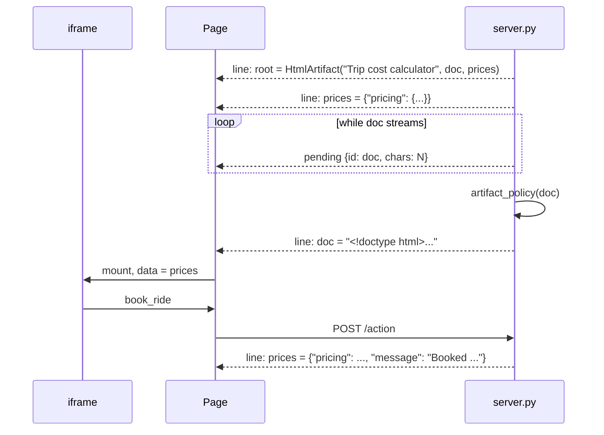
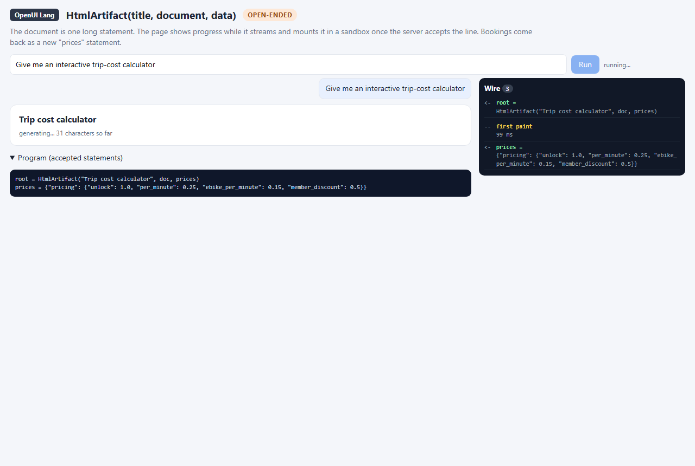
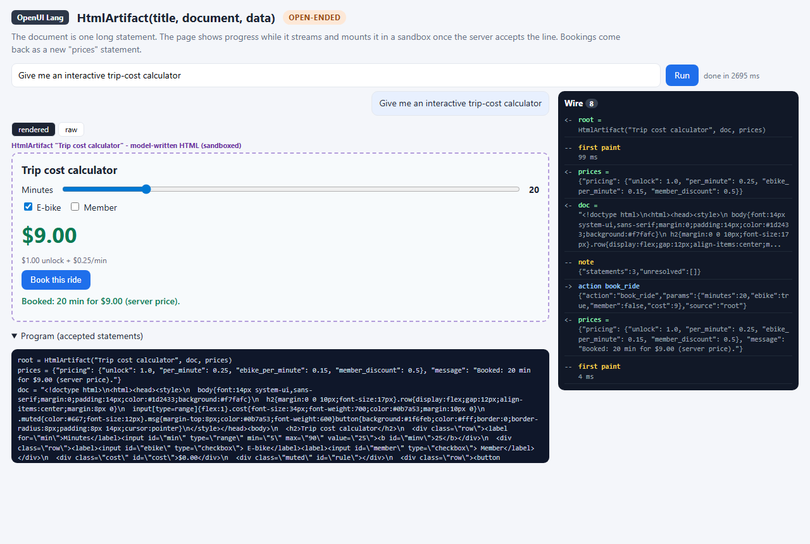

# OpenUI Lang · Open-ended: HtmlArtifact(title, document, data)

**Mode:** open-ended · **Run:** `python server.py` → http://127.0.0.1:8503 · **Demo:** `python demo.py`

The library has one component, `HtmlArtifact`, modelled on OpenUI's html-artifact example. The model writes `root` first, then the small `prices` statement, then the long `doc` string on one line. While that line streams, the page shows progress; the server checks the document with the content policy before accepting the line; the page then mounts it in a sandbox with Raw / Rendered tabs. A booking from inside the sandbox comes back as a new `prices` statement, which replaces the old one, and the frame receives it as data.

## What you will learn

- How a one-statement-per-line language streams a 2,000-character document (and how to show progress for it).
- A policy that works whichever statement arrives first, the call or the document.
- Data flowing into an artifact through an ordinary reference that the server can redefine.

## How it works



## Run it

```bash
python demo.py
python server.py      # http://127.0.0.1:8503
python -m pytest -q
```

## Recorded output

<!-- demo-output:start -->
```text

=== 1. The stream: progress events while the document line grows ===
  pending  {'id': 'root', 'component': 'HtmlArtifact', 'chars': 28}
  line     root = HtmlArtifact("Trip cost calculator", doc, prices)  (56 chars, 13 tokens)
  pending  {'id': 'prices', 'component': None, 'chars': 27}
  line     prices = {"pricing": {"unlock": 1.0, "per_minute": 0.25, "ebike_per_mi...  (107 chars, 44 tokens)
  pending  {'id': 'doc', 'component': None, 'chars': 31}
  pending  {'id': 'doc', 'component': None, 'chars': 451}
  pending  {'id': 'doc', 'component': None, 'chars': 871}
  pending  {'id': 'doc', 'component': None, 'chars': 1291}
  pending  {'id': 'doc', 'component': None, 'chars': 1711}
  pending  {'id': 'doc', 'component': None, 'chars': 2131}
  line     doc = "<!doctype html>\n<html><head><style>\n  body{font:14px system-u...  (2274 chars, 780 tokens)
  note     {'statements': 3, 'unresolved': []}

=== 2. The policy runs on the document, whichever statement comes first ===
   accepted
   ['doc: network access is not allowed']

=== 3. In the browser ===
  while streaming: Trip cost calculator |  | generating... 31 characters so far
  saved demo_streaming.png
  frame after the new prices statement: Booked: 20 min for $9.00 (server price).
  saved demo.png
  raw tab shows the source: <!doctype html> <html><head><style>   body{font:14px system- ...
```
<!-- demo-output:end -->

| While the document line streams | Mounted and booked |
|---|---|
|  |  |

## Code walkthrough

**1. Three statements; the long one last.**

`server.py`:

```python
        'root = HtmlArtifact("Trip cost calculator", doc, prices)',
        f"prices = {json.dumps({'pricing': bikes.PRICING})}",
        f"doc = {json.dumps(bikes.TRIP_CALCULATOR_HTML)}",
```

**2. Progress for the line that is still streaming.**

`../_shared/openui.py`:

```python
        info = splitter.pending()
        if info and (reported is None or info["id"] != reported[0] or info["chars"] - reported[1] >= 400):
            reported = (info["id"], info["chars"])
            yield "pending", info
```

**3. The policy checks the document whether the call or the string arrives first.**

`../_shared/openui.py`:

```python
            elif doc[0] == "ref" and doc[1] == sid and node[0] == "lit":
                docs.append(node[1])  # this line is the document an earlier call points to
```

**4. Raw / Rendered tabs; the frame gets `data` from the referenced statement.**

`../_shared/render.mjs`:

```js
    if (p.data && typeof p.data === 'object' && !isNode(p.data)) ctx.frameData.set(node.id, p.data);
    const body = tab === 'raw'
```

**5. The answer to a booking is one statement that replaces `prices`.**

`server.py`:

```python
    line = f"prices = {json.dumps({'pricing': network.pricing, 'message': message})}"  # replaces the old statement
```

## What to notice

- Almost all of the program's tokens are the document line (about 780 of 840, see the output). The two layout statements cost almost nothing.
- The artifact's document statement never changes after the booking, so the iframe stays mounted while its data changes.
- The policy blocks a document with `new WebSocket(...)` even when it arrives after the call that uses it.

## Try it yourself

1. Put `doc` before `root` in the scripted reply and watch where the page shows progress.
2. Switch to the Raw tab during streaming and after completion.
3. Add a second artifact that shares the same `prices` statement.
