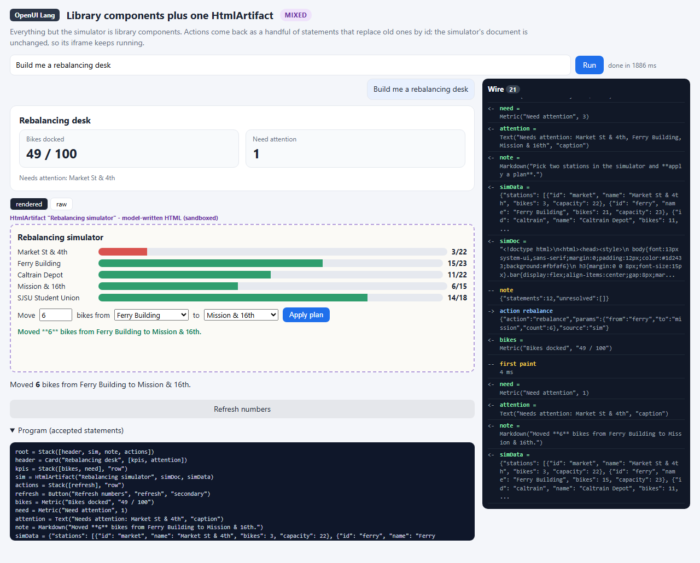

# OpenUI Lang · Mixed: library components plus one HtmlArtifact

**Mode:** mixed · **Run:** `python server.py` → http://127.0.0.1:8504 · **Demo:** `python demo.py`

A rebalancing desk: header, metrics, caption, note and button are library components; the simulator is an `HtmlArtifact`. The prompt carries OpenUI's own rule for the pattern: use the artifact only for something interactive the library cannot express. The application answers actions in OpenUI Lang too: it resends the few statements that changed (two metrics, a caption, a note, the simulator's data), and each replaces the old statement with the same id. The artifact's document does not change, so the live iframe stays where it is.

## What you will learn

- The hybrid rule in a prompt, and the cost it controls (the artifact dominates the token count).
- Updates as statements: an application can speak the model's UI language back to the page.
- Why an unchanged document statement means an untouched iframe.

## How it works

```mermaid
sequenceDiagram
    participant F as Simulator (HtmlArtifact)
    participant P as Page
    participant S as server.py
    S-->>P: 12 lines: root, header, kpis, sim, actions, refresh, bikes, need, attention, note, simData, simDoc
    F->>P: rebalance {from, to, count}
    P->>S: POST /action (source "sim")
    S-->>P: bikes = ..., need = ..., attention = ..., note = ..., simData = {...}
    Note over P,F: catalog part updates; simDoc unchanged, so the frame keeps its state and gets simData
```

## Run it

```bash
python demo.py
python server.py      # http://127.0.0.1:8504
python -m pytest -q
```

## Recorded output

<!-- demo-output:start -->
```text

=== 1. Where the tokens go ===
  12 statements, 1389 tokens (tiktoken o200k_base)
  the simulator document alone: 1072 tokens (77%)
  the other 11 statements: 317 tokens

=== 2. An action answered with statements ===
  bikes = Metric("Bikes docked", "49 / 100")
  need = Metric("Need attention", 1)
  attention = Text("Needs attention: Market St & 4th", "caption")
  note = Markdown("Moved **6** bikes from Ferry Building to Mission & 16th.")
  simData = {"stations": [{"id": "market", "name": "Market St & 4th", "bikes": 3, "capacity": 22}, {"i

=== 3. In the browser ===
  catalog part: Rebalancing desk | Bikes docked | 49 / 100 | Need attention | 1 |  | Needs attention: Market St & 4th
  note: Moved 6 bikes from Ferry Building to Mission & 16th. | simulator kept its selection: ferry
  saved demo.png
```
<!-- demo-output:end -->



## Code walkthrough

**1. The prompt rule for the hybrid.**

`server.py`:

```python
SYSTEM = (openui.prompt(LIBRARY) + "\nUse the library components for everything you can. Use one HtmlArtifact only when "
          "the user needs something interactive the library cannot express (a simulator); inline CSS/JS only. "
```

**2. The layout references the artifact and its data by name.**

`server.py`:

```python
        "root = Stack([header, sim, note, actions])",
...
        'sim = HtmlArtifact("Rebalancing simulator", simDoc, simData)',
```

**3. The statements the application owns.**

`server.py`:

```python
    return [f'bikes = Metric("Bikes docked", "{summary["bikes"]} / {summary["capacity"]}")',
            f'need = Metric("Need attention", {len(summary["needs_attention"])})',
```

**4. Actions must come from the right source.**

`server.py`:

```python
    if body.get("action") == "rebalance" and body.get("source") == "sim":
```

**5. The artifact's signature depends on its document, not its data.**

`../_shared/render.mjs`:

```js
    ? { title: node.props.title, doc: typeof node.props.document === 'string' ? hash(node.props.document) : 'pending', tab: ctx.tabs.get(node.id), pending: ctx.pending.get(node.props.document?.id)?.chars }
```

## What to notice

- The token split in the recorded output: the simulator document is about three quarters of the whole program; eleven statements of layout and data are the rest.
- After the action, the program still has 12 statements, and `simDoc` and `sim` are unchanged (a test checks it).
- The simulator keeps its selection after the update.

## Try it yourself

1. Replace the simulator with library components (a `Table` and two `Button`s). What does the program cost now, and what can the user no longer do?
2. Add a `Markdown` statement that the application updates after every action with a short history.
3. Make the Refresh button redefine `simData` only and confirm the metrics stay as they were.
