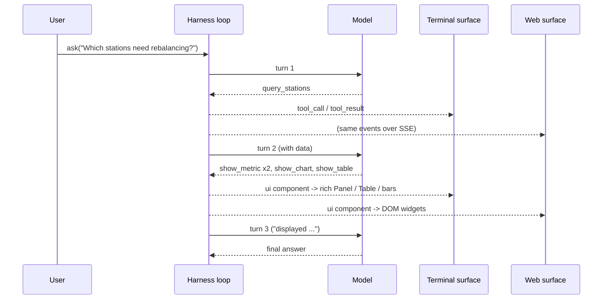
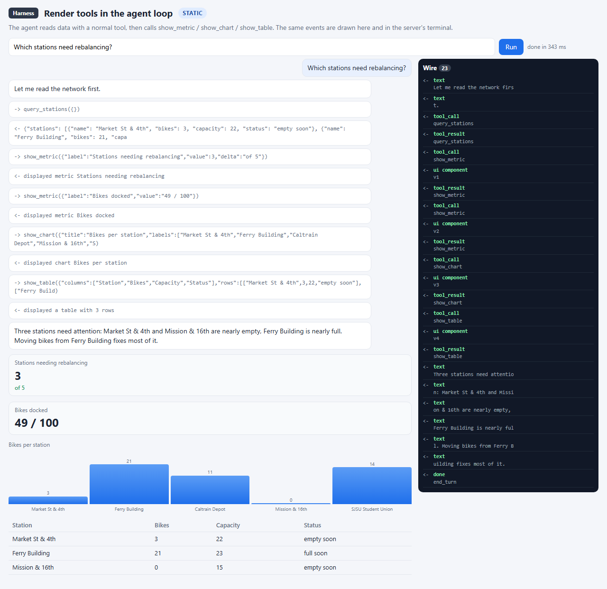

# Harness · Static: render tools in the agent loop

**Mode:** static · **Run:** `python cli.py "Which stations need rebalancing?"` or `python server.py` → http://127.0.0.1:8601 · **Demo:** `python demo.py`

The harness gains three tools whose only job is to show something: `show_metric`, `show_table` and `show_chart`. Each returns a short result for the model ("displayed ...") and a `ui` event for the surfaces. The components are pre-built in each surface: rich renderables in the terminal, DOM widgets in the browser. The model reads data with an ordinary tool, picks components and fills their props.

## What you will learn

- How a harness turns "show the user X" into tool calls with validated inputs.
- The split between what the model reads (a one-line result) and what the user sees (a component).
- One agent, two surfaces: the same event stream drawn by a terminal and a browser.

## How it works



## Run it

```bash
python cli.py "Which stations need rebalancing?"   # terminal only
python server.py                                    # http://127.0.0.1:8601; the server's terminal mirrors it
python demo.py
python -m pytest -q
```

## Recorded output

<!-- demo-output:start -->
```text

=== 1. Terminal surface: python cli.py "Which stations need rebalancing?" ===
Let me read the network first.
  -> query_stations({})
  <- {"stations": [{"name": "Market St & 4th", "bikes": 3, "capacity": 22, "status": "...
  -> show_metric({"label": "Stations needing rebalancing", "value": 3, "delta": "of 5"})
+- Stations needing rebalancing -+
| 3  of 5                        |
+--------------------------------+
  <- displayed metric Stations needing rebalancing
  -> show_metric({"label": "Bikes docked", "value": "49 / 100"})
+- Bikes docked -+
| 49 / 100       |
+----------------+
  <- displayed metric Bikes docked
  -> show_chart({"title": "Bikes per station", "labels": ["Market St & 4th", "Ferry...)
Bikes per station
Market St & 4th    ###                      3
Ferry Building     ######################## 21
Caltrain Depot     #############            11
Mission & 16th                              0
SJSU Student Union ################         14
  <- displayed chart Bikes per station
  -> show_table({"columns": ["Station", "Bikes", "Capacity", "Status"], "rows": [["...)
+-------------------------------------------------+
| Station         | Bikes | Capacity | Status     |
|-----------------+-------+----------+------------|
| Market St & 4th | 3     | 22       | empty soon |
| Ferry Building  | 21    | 23       | full soon  |
| Mission & 16th  | 0     | 15       | empty soon |
+-------------------------------------------------+
  <- displayed a table with 3 rows
Three stations need attention: Market St & 4th and Mission & 16th are nearly empty, Ferry Building is nearly full. Moving bikes from Ferry Building fixes most of it.
  [done: end_turn]

=== 2. Web surface: the same events in the browser ===
  views on the page: v1, v2, v3, v4
  final answer: Three stations need attention: Market St & 4th and Mission & 16th are nearly empty, Ferry Building i
  saved demo.png
```
<!-- demo-output:end -->



## Code walkthrough

**1. A render tool is a normal tool that also returns a UI event.**

`agent.py`:

```python
    @registry.add("show_table", "Show the user a table.", obj(["columns", "rows"], columns=ARRAY, rows=ARRAY))
    def show_table(columns, rows):
        return f"displayed a table with {len(rows)} rows", [ui("Table", {"columns": columns, "rows": rows})]
```

**2. Every tool input is validated before the function runs.** Bad input is a result the model can read, never an exception.

`../_shared/harness/tools.py`:

```python
        errors = [f"{'/'.join(map(str, e.path)) or 'input'}: {e.message}" for e in self._validator.iter_errors(args)]
        if errors:
            return json.dumps({"error": "invalid input", "details": errors}), [], True
```

**3. The loop forwards UI events to whoever is listening.**

`../_shared/harness/loop.py`:

```python
            for event in events:
                if event.get("actions") is not None:  # a UI declares which actions it may send back
                    self.allowed_actions[event["view"]] = set(event["actions"])
                yield event
```

**4. The terminal surface turns a component into a rich renderable.**

`../_shared/harness/terminal.py`:

```python
    if name == "Table":
        table = Table(*map(str, p.get("columns", [])), box=box.ASCII)
        for row in p.get("rows", []):
            table.add_row(*map(str, row))
        return table
```

**5. The web surface turns the same event into a DOM widget.**

`../_shared/client.mjs`:

```js
    if (e.kind === 'component') {
      const build = registry[e.component] ?? ((p) => w.alert({ text: `unknown component ${e.component}` }));
      slot(e.view).el.replaceChildren(build(e.props, [], { act: () => {} }));
```

**6. While the browser is in use, the server's terminal mirrors every event.**

`../_shared/harness/web.py`:

```python
    def relay(events):
        for event in events:
            if terminal:
                terminal.handle(event)
            yield event
```

## What to notice

- The model reads `displayed a table with 3 rows`; the user sees the table. Keep results short: they enter the context window.
- The terminal output is pure ASCII (a test checks it), so it works in any console and log file.
- `python server.py` shows both surfaces at once: the browser and, in the terminal you started it from, the same UI as text.

## Try it yourself

1. Add a `show_station(name)` render tool that emits a `StationCard`; draw it in `terminal.py` as a Panel.
2. Return the full rows in `show_table`'s result instead of a count, and compare the size of the next model request.
3. Run `python cli.py` with your own question and `GENUI_LIVE=1` (needs an API key) to see a real model choose the tools.
