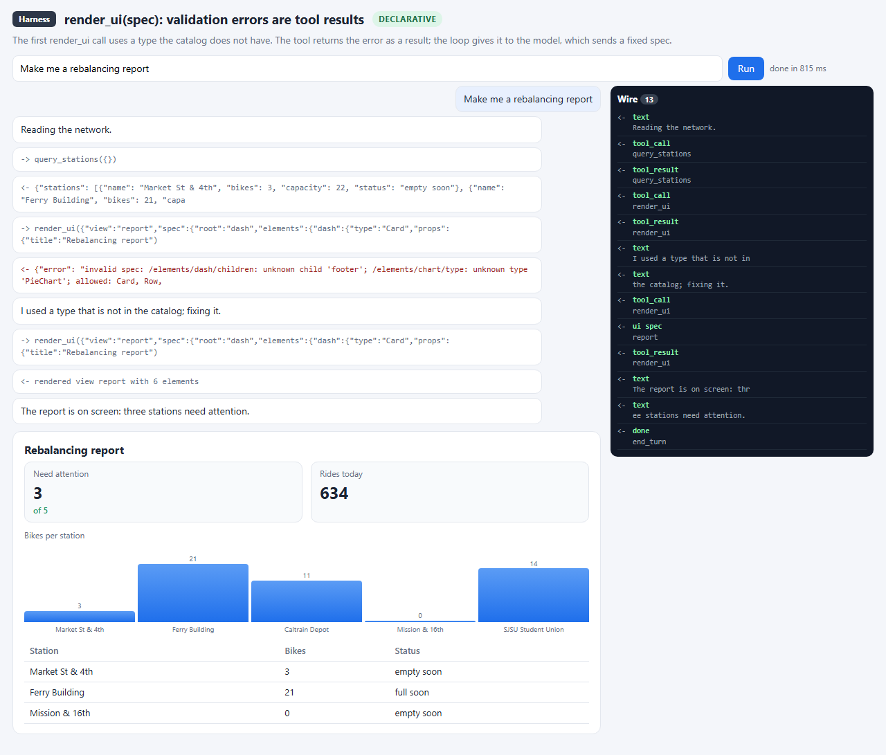

# Harness · Declarative: render_ui(spec), where validation errors are tool results

**Mode:** declarative · **Run:** `python cli.py "Make me a rebalancing report"` or `python server.py` → http://127.0.0.1:8602 · **Demo:** `python demo.py`

Instead of one tool per component, the model composes a layout from a catalog and passes it to one tool, `render_ui(view, spec)`. The tool validates the spec. An invalid spec is not an exception: it is an error *result*, and the loop hands it back to the model, which fixes the spec on its next turn. The scripted model makes two typical mistakes the first time: an invented component type and a dangling child id.

## What you will learn

- A declarative UI tool, and why its validator is the most important part.
- Self-correction inside the harness loop, with no special code: errors are just results.
- The same validated spec drawn as rich panels in a terminal and as DOM in a browser.

## How it works

```mermaid
sequenceDiagram
    participant H as Harness
    participant M as Model
    participant S as Surfaces
    M-->>H: query_stations
    H->>M: data
    M-->>H: render_ui(spec with PieChart + "footer")
    H->>M: error result: unknown type 'PieChart'; unknown child 'footer'
    M-->>H: "fixing it" + render_ui(valid spec)
    H-->>S: ui spec (terminal panels, web elements)
    H->>M: "rendered view report with 6 elements"
    M-->>H: final answer
```

## Run it

```bash
python cli.py "Make me a rebalancing report"
python server.py      # http://127.0.0.1:8602
python demo.py
python -m pytest -q
```

## Recorded output

<!-- demo-output:start -->
```text

=== 1. Terminal surface: python cli.py "Make me a rebalancing report" ===
Reading the network.
  -> query_stations({})
  <- {"stations": [{"name": "Market St & 4th", "bikes": 3, "capacity": 22, "status": "...
  -> render_ui({"view": "report", "spec": {"root": "dash", "elements": {"dash": {"...)
  <- {"error": "invalid spec: /elements/dash/children: unknown child 'footer'; /elemen...
I used a type that is not in the catalog; fixing it.
  -> render_ui({"view": "report", "spec": {"root": "dash", "elements": {"dash": {"...)
+--------------------------------------- Rebalancing report ---------------------------------------+
| +- Need attention -+  +- Rides today -+                                                          |
| | 3  of 5          |  | 634           |                                                          |
| +------------------+  +---------------+                                                          |
| Bikes per station                                                                                |
| Market St & 4th    ###                      3                                                    |
| Ferry Building     ######################## 21                                                   |
| Caltrain Depot     #############            11                                                   |
| Mission & 16th                              0                                                    |
| SJSU Student Union ################         14                                                   |
| +--------------------------------------+                                                         |
| | Station         | Bikes | Status     |                                                         |
| |-----------------+-------+------------|                                                         |
| | Market St & 4th | 3     | empty soon |                                                         |
| | Ferry Building  | 21    | full soon  |                                                         |
| | Mission & 16th  | 0     | empty soon |                                                         |
| +--------------------------------------+                                                         |
+--------------------------------------------------------------------------------------------------+
  <- rendered view report with 6 elements
The report is on screen: three stations need attention.
  [done: end_turn]

=== 2. Web surface ===
  transcript:
    Reading the network.
    -> query_stations({})
    <- {"stations": [{"name": "Market St & 4th", "bikes": 3, "capacity": 22, "status": "empty soon"}, {"name"
    -> render_ui({"view":"report","spec":{"root":"dash","elements":{"dash":{"type":"Card","props":{"title":"R
    <- {"error": "invalid spec: /elements/dash/children: unknown child 'footer'; /elements/chart/type: unknow
    I used a type that is not in the catalog; fixing it.
    -> render_ui({"view":"report","spec":{"root":"dash","elements":{"dash":{"type":"Card","props":{"title":"R
    <- rendered view report with 6 elements
    The report is on screen: three stations need attention.
  rendered: Rebalancing report
  saved demo.png
```
<!-- demo-output:end -->



## Code walkthrough

**1. One tool, one catalog check.**

`agent.py`:

```python
    def render_ui(view, spec):
        errors = CATALOG_V1.check_spec(spec)
        if errors:
            raise ToolError("invalid spec: " + "; ".join(errors[:6]))
```

**2. The spec declares which actions its buttons may send back.**

`agent.py`:

```python
        actions = sorted({e["props"]["action"] for e in spec["elements"].values() if e["type"] == "Button"})
        event = {"type": "ui", "kind": "spec", "view": view, "spec": spec, "actions": actions}
```

**3. The catalog check finds shape errors with paths.**

`../../../common/genui_common/elements.py`:

```python
        if kind not in self.types:
            return [f"/elements/{element_id}/type: unknown type {kind!r}; allowed: {', '.join(self.types)}"]
```

**4. A `ToolError` becomes an `is_error` result; the loop simply continues.**

`../_shared/harness/tools.py`:

```python
        except ToolError as error:
            return json.dumps({"error": str(error)}), [], True
```

**5. The terminal draws the spec as nested rich renderables.**

`../_shared/harness/terminal.py`:

```python
        if element["type"] == "Card":
            return Panel(Group(*kids), title=props.get("title"), box=box.ASCII)
        if element["type"] == "Row":
            return Columns(kids, padding=(0, 2))
```

## What to notice

- Only the valid spec reaches the surfaces: one `ui` event for two `render_ui` calls (a test checks it).
- The error message names both problems with their paths, which is what lets the model fix them in one try.
- The terminal panel and the browser card come from the same spec.

## Try it yourself

1. Add a `Sparkline` type to the catalog (Python), the browser registry and `terminal.py`.
2. Make the scripted model fail three times in a row and set `max_turns=3`. What does the user see?
3. Shorten the error message to "invalid spec" and predict how a real model would cope.
