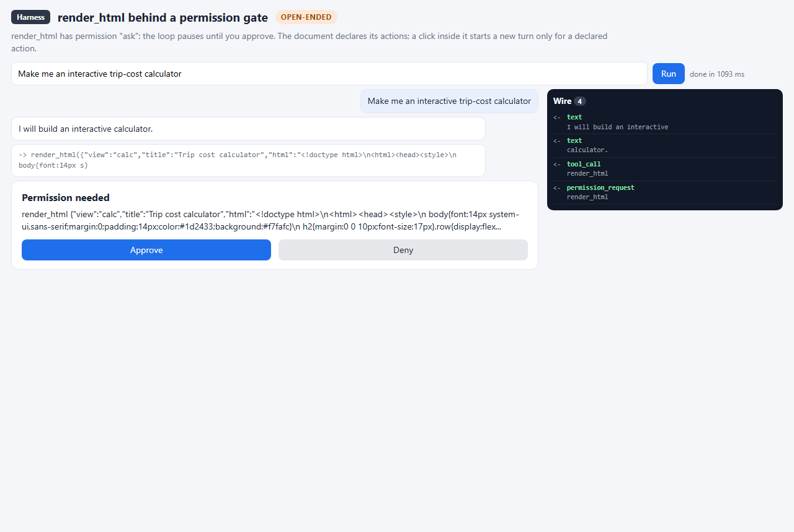
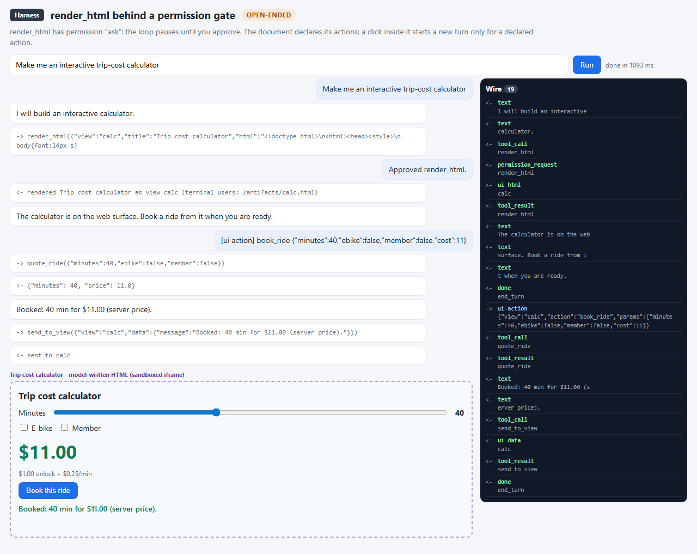

# Harness · Open-ended: render_html behind a permission gate

**Mode:** open-ended · **Run:** `python cli.py "Make me an interactive trip-cost calculator"` or `python server.py` → http://127.0.0.1:8603 · **Demo:** `python demo.py`

`render_html` lets the model ship a whole HTML document. Two harness mechanisms guard it: permission `"ask"` (the loop pauses until the user approves, the same gate a coding harness uses before running a shell command) and a content policy whose violations are error results. The document declares the actions it may send back; a click inside it starts a new turn only for a declared action. `send_to_view` lets the model push data into a view it rendered.

## What you will learn

- Permissions in a harness: pause, approve or deny, resume the same batch of tool calls.
- How a generated view talks back to the agent safely: declared actions only.
- How a terminal user reaches an HTML artifact, and why it is served with a `Content-Security-Policy: sandbox ...` header.

## How it works

```mermaid
sequenceDiagram
    participant U as User
    participant H as Harness
    participant M as Model
    participant F as Artifact (iframe)
    M-->>H: render_html(view "calc", html, actions ["book_ride"])
    H-->>U: permission_request (loop paused)
    U->>H: approve
    H->>H: check_html, store artifact (CSP), declare actions
    H-->>U: ui html (web: iframe; terminal: link)
    F->>H: ui_action("calc", "book_ride", {...})  (declared: accepted)
    M-->>H: quote_ride -> send_to_view("calc", {message})
    H-->>F: ui data {message}
    F->>H: ui_action("calc", "delete_account")  -> error: not declared
```

## Run it

```bash
python cli.py "Make me an interactive trip-cost calculator"          # asks y/N
python cli.py "Make me an interactive trip-cost calculator" --yes
python server.py      # http://127.0.0.1:8603
python demo.py
python -m pytest -q
```

## Recorded output

<!-- demo-output:start -->
```text

=== 1. Terminal: python cli.py "Make me an interactive trip-cost calculator" --no ===
I will build an interactive calculator.
  -> render_html({"view": "calc", "title": "Trip cost calculator", "html": "<!doctyp...)
+--------------------------------------- permission needed ----------------------------------------+
| render_html {"view": "calc", "title": "Trip cost calculator", "html": "<!doctype                 |
| html>\n<html><head><style>\n  body{font:14px                                                     |
| system-ui,sans-serif;margin:0;padding:14px;color:#1d2433;background:#f7fafc}\n  h2{margin:0 0    |
| 10px;font-size:17px}.row{disp...                                                                 |
+--------------------------------------------------------------------------------------------------+
  <- {"error": "the user denied this action"}
Understood, I will not show it.
  [done: end_turn]

=== 2. Terminal: the same with --yes ===
I will build an interactive calculator.
  -> render_html({"view": "calc", "title": "Trip cost calculator", "html": "<!doctyp...)
+--------------------------------------- permission needed ----------------------------------------+
| render_html {"view": "calc", "title": "Trip cost calculator", "html": "<!doctype                 |
| html>\n<html><head><style>\n  body{font:14px                                                     |
| system-ui,sans-serif;margin:0;padding:14px;color:#1d2433;background:#f7fafc}\n  h2{margin:0 0    |
| 10px;font-size:17px}.row{disp...                                                                 |
+--------------------------------------------------------------------------------------------------+
+------------------------------------------- view calc --------------------------------------------+
| Trip cost calculator: interactive HTML, 2144 chars.                                              |
| Terminal fallback: open /artifacts/calc.html on the web surface.                                 |
+--------------------------------------------------------------------------------------------------+
  <- rendered Trip cost calculator as view calc (terminal users: /artifacts/calc.html)
The calculator is on the web surface. Book a ride from it when you are ready.
  [done: end_turn]

=== 3. Web surface: approve, use the artifact, a declared and an undeclared action ===
  paused: Permission needed |  | render_html {"view":"calc","title":"Trip cost calculator","html":"<!doctype html>\n<html><head><s
  saved demo_permission.png
  frame after send_to_view: Booked: 40 min for $11.00 (server price).
  saved demo.png
  GET /artifacts/calc.html CSP header: sandbox allow-scripts; default-src 'none'; script-src 'unsaf ...
  undeclared action: {'type': 'error', 'message': "action 'delete_account' was not declared by view 'calc'"}
```
<!-- demo-output:end -->

| Paused for permission | Approved, used, booked |
|---|---|
|  |  |

## Code walkthrough

**1. The tool is marked `ask`, and checks the document before storing it.**

`agent.py`:

```python
                  permission="ask")
    def render_html(view, title, html, actions):
        problems = check_html(html)
        if problems:
            raise ToolError("content policy: " + "; ".join(problems))
        ARTIFACTS[view] = inject_csp(html)
```

**2. Resuming continues the same batch; a denial is a result the model reads.**

`../_shared/harness/loop.py`:

```python
        if approve:
            self.approved.add(request_id)
        else:
            call = batch["calls"][batch["index"]]
            content = json.dumps({"error": "the user denied this action"})
```

**3. Only declared actions start a turn.**

`../_shared/harness/loop.py`:

```python
        if action not in self.allowed_actions.get(view, set()):
            yield {"type": "error", "message": f"action {action!r} was not declared by view {view!r}"}
            return
```

**4. Artifacts are served with a CSP header that includes `sandbox`.** Opened directly in a tab, the document still gets an opaque origin.

`../_shared/harness/web.py`:

```python
HEADER_CSP = ("sandbox allow-scripts; default-src 'none'; script-src 'unsafe-inline'; "
```

**5. The web surface shows the permission card and posts the decision.**

`../_shared/client.mjs`:

```js
    async function decide(approve) {
      box.remove();
      shell.say('user', approve ? `Approved ${e.name}.` : `Denied ${e.name}.`);
      await stream('/approve', { id: e.id, approve });
    }
```

## What to notice

- With `--no`, the model reads "the user denied this action" and answers accordingly; nothing is stored.
- The terminal cannot run HTML, so it prints the artifact URL instead; the browser mounts it in a sandbox.
- The undeclared `delete_account` action never reaches the model.

## Try it yourself

1. Change `render_html` to `permission="allow"` and compare the flow. When would you choose each?
2. Add `"reset"` to the declared actions and handle it in the scripted model.
3. Open `/artifacts/calc.html` directly in a browser tab and check `document.domain` in its console.
