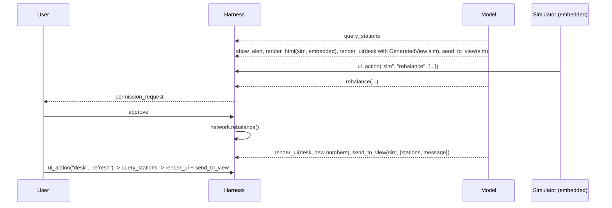
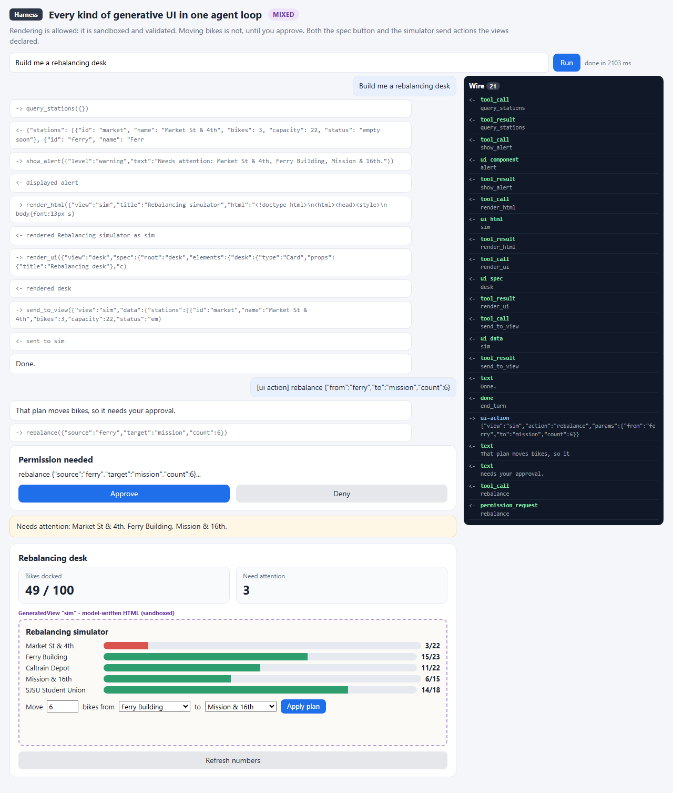
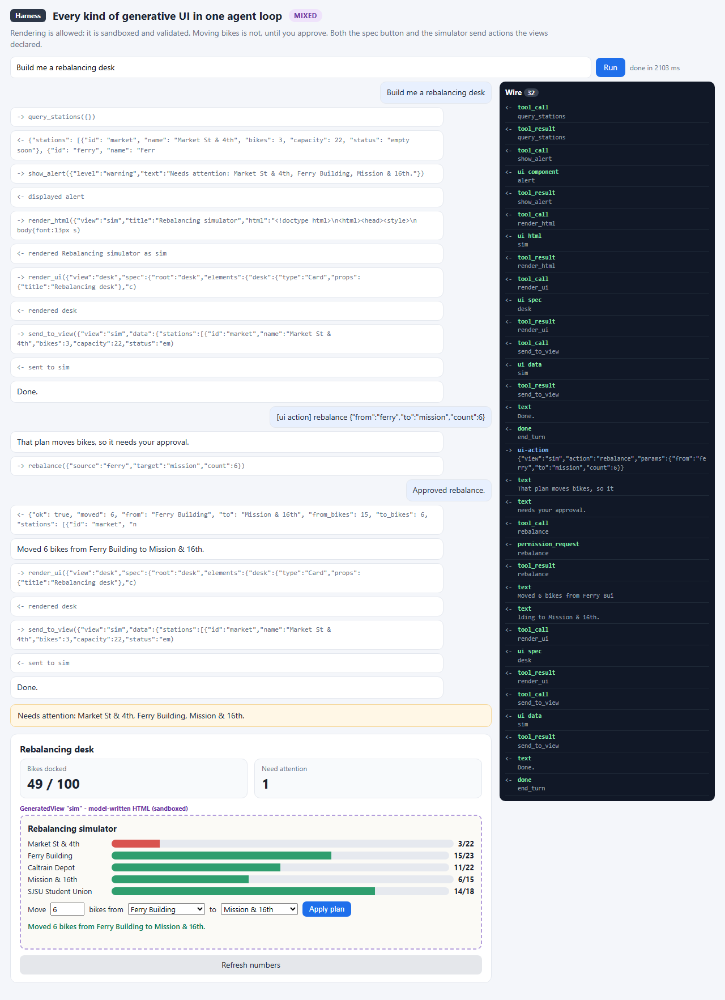

# Harness · Mixed: every kind of generative UI in one agent loop

**Mode:** mixed · **Run:** `python cli.py "Build me a rebalancing desk"` or `python server.py` → http://127.0.0.1:8604 · **Demo:** `python demo.py`

| Tool | Kind | Permission |
|---|---|---|
| `show_alert` | static: a pre-built component | allow |
| `render_ui` | declarative: a validated spec with one `GeneratedView` | allow |
| `render_html` | open-ended: the simulator, embedded in that `GeneratedView` | allow |
| `send_to_view` | data into a rendered view | allow |
| `rebalance` | a side effect: moves bikes | **ask** |

Rendering is allowed: it is sandboxed and validated. Changing the world is not, until the user says yes. UI actions from the spec's button and from the simulator both come back as turns, and only if the view declared them.

## What you will learn

- How to compose all three generation modes in one harness turn.
- Where to put the permission line: on side effects, not on rendering.
- How a re-rendered spec keeps an embedded generated view alive.

## How it works



## Run it

```bash
python cli.py "Build me a rebalancing desk"
python server.py      # http://127.0.0.1:8604
python demo.py
python -m pytest -q
```

## Recorded output

<!-- demo-output:start -->
```text

=== 1. Terminal surface: build the desk, then a simulator action, approved ===
  -> query_stations({})
  <- {"stations": [{"id": "market", "name": "Market St & 4th", "bikes": 3, "capacity":...
  -> show_alert({"level": "warning", "text": "Needs attention: Market St & 4th, Fer...)
+-------------------------------------------- warning ---------------------------------------------+
| Needs attention: Market St & 4th, Ferry Building, Mission & 16th.                                |
+--------------------------------------------------------------------------------------------------+
  <- displayed alert
  -> render_html({"view": "sim", "title": "Rebalancing simulator", "html": "<!doctyp...)
  [ui html: Rebalancing simulator, embedded in a GeneratedView; actions ['rebalance']]
  <- rendered Rebalancing simulator as sim
  -> render_ui({"view": "desk", "spec": {"root": "desk", "elements": {"desk": {"ty...)
+---------------------------------------- Rebalancing desk ----------------------------------------+
| +- Bikes docked -+  +- Need attention -+                                                         |
| | 49 / 100       |  | 3                |                                                         |
| +----------------+  +------------------+                                                         |
| [interactive view 'sim': open the web surface]                                                   |
| [ Refresh numbers ]  (refresh)                                                                   |
+--------------------------------------------------------------------------------------------------+
  <- rendered desk
  -> send_to_view({"view": "sim", "data": {"stations": [{"id": "market", "name": "Mar...)
  [view sim received new data]
  <- sent to sim
Done.
  [done: end_turn]
That plan moves bikes, so it needs your approval.
  -> rebalance({"source": "ferry", "target": "mission", "count": 6})
+--------------------------------------- permission needed ----------------------------------------+
| rebalance {"source": "ferry", "target": "mission", "count": 6}                                   |
+--------------------------------------------------------------------------------------------------+
  <- {"ok": true, "moved": 6, "from": "Ferry Building", "to": "Mission & 16th", "from_...
Moved 6 bikes from Ferry Building to Mission & 16th.
  -> render_ui({"view": "desk", "spec": {"root": "desk", "elements": {"desk": {"ty...)
+---------------------------------------- Rebalancing desk ----------------------------------------+
| +- Bikes docked -+  +- Need attention -+                                                         |
| | 49 / 100       |  | 1                |                                                         |
| +----------------+  +------------------+                                                         |
| [interactive view 'sim': open the web surface]                                                   |
| [ Refresh numbers ]  (refresh)                                                                   |
+--------------------------------------------------------------------------------------------------+
  <- rendered desk
  -> send_to_view({"view": "sim", "data": {"stations": [{"id": "market", "name": "Mar...)
  [view sim received new data]
  <- sent to sim
Done.
  [done: end_turn]

=== 2. Web surface ===
  desk: Bikes docked 49 / 100 Need attention 3 | alert: Needs attention: Market St & 4th, Ferry Building, Mission & 16th.
  saved demo_permission.png
  after approval: Bikes docked 49 / 100 Need attention 1 | simulator: Moved 6 bikes from Ferry Building to Mission & 16th. | selection kept: ferry
  saved demo.png
  refresh (a declared spec action): Numbers refreshed.
```
<!-- demo-output:end -->

| Waiting for approval | After approval and refresh |
|---|---|
|  |  |

## Code walkthrough

**1. The side effect is the one tool that asks.**

`agent.py`:

```python
    @registry.add("rebalance", "Move bikes between stations. Needs the user's approval.",
                  obj(["source", "target", "count"], source=S, target=S, count={"type": "integer", "minimum": 1}),
                  permission="ask")
```

**2. A spec may embed a generated view only if that artifact exists.**

`agent.py`:

```python
        missing = [e["props"]["artifact"] for e in spec.get("elements", {}).values()
                   if e.get("type") == "GeneratedView" and e["props"]["artifact"] not in ARTIFACTS]
```

**3. One model turn uses all three modes.**

`agent.py`:

```python
        return [tool("show_alert", {"level": "warning", "text": f"Needs attention: {names}."}),
                tool("render_html", {"view": "sim", "title": "Rebalancing simulator", "html": bikes.REBALANCE_SIMULATOR_HTML,
                                     "actions": ["rebalance"], "placement": "embedded"}),
                tool("render_ui", {"view": "desk", "spec": desk(stations)}),
                tool("send_to_view", {"view": "sim", "data": {"stations": stations}})]
```

**4. On the page, an embedded artifact is drawn by the spec's GeneratedView.**

`../_shared/client.mjs`:

```js
      if (e.placement === 'embedded') { // a GeneratedView inside a spec shows it
        for (const s of slots.values()) if (s.spec?.spec) s.spec.render(s.spec.spec);
        return;
      }
```

**5. Data for the embedded view goes through the spec's frame host.**

`../_shared/client.mjs`:

```js
      for (const s of slots.values()) s.spec?.frames.send(e.data, e.view);
```

## What to notice

- After the simulator's action, the loop stops at `permission needed`; a test checks that no bike moved before approval.
- After approval, the desk is re-rendered with new numbers and the simulator keeps its selection (same artifact, same slot).
- The harness accepts `rebalance` from `sim` and `refresh` from `desk` only: `allowed_actions == {"sim": {"rebalance"}, "desk": {"refresh"}}`.

## Try it yourself

1. Deny the permission and read what the model says.
2. Add an "Undo last move" button to the spec that calls `rebalance` in reverse (still behind the permission).
3. Make `render_html` ask for permission too, and decide whether the extra click is worth it.
